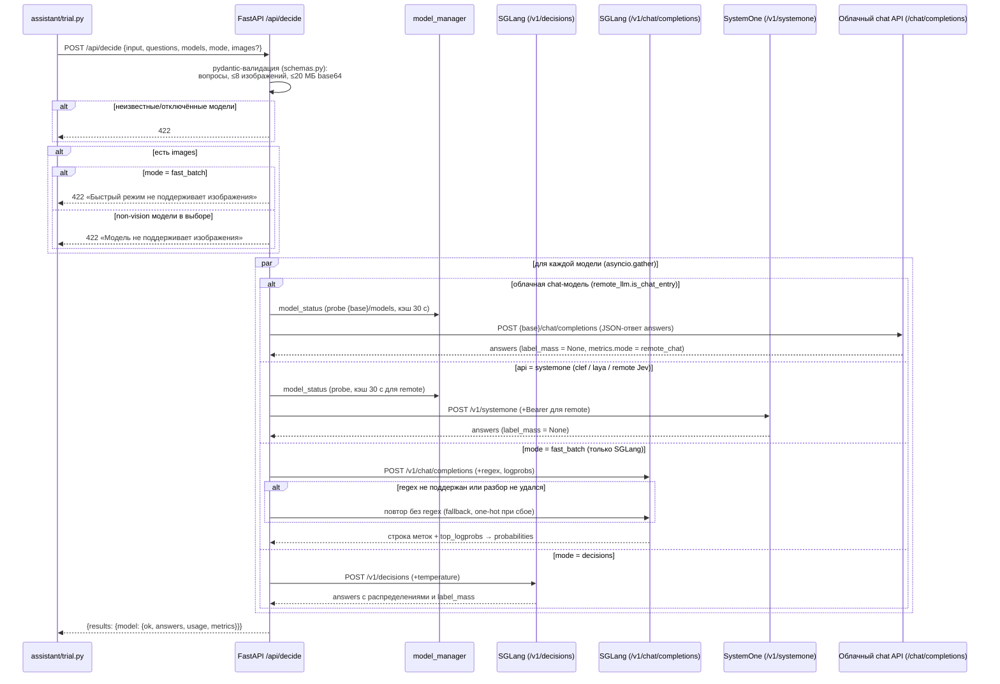
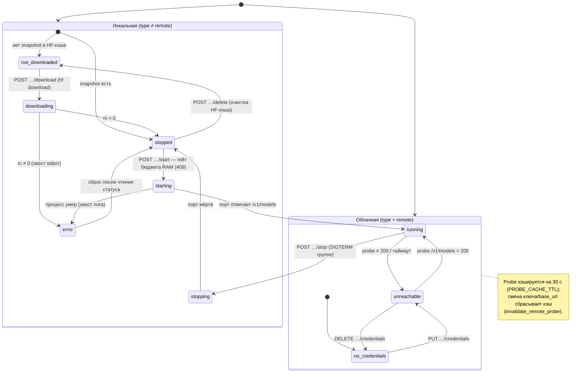
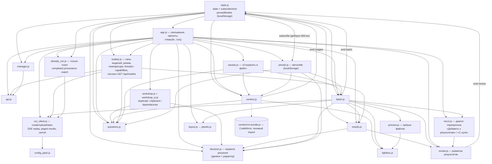
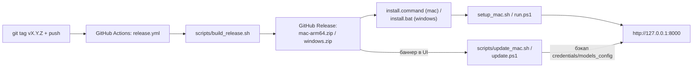

# ARCHITECTURE.md — Decision-QA

> Продукт выпускается под именем «Вердикт»; Decision-QA — внутреннее кодовое имя.

> Правило: любое изменение архитектуры (новые модули, эндпоинты, статусы,
> потоки данных) обновляет этот файл в том же изменении.

## Обзор

Decision-QA — локальное веб-приложение с прозрачным владельцем `local` и
изолированными Bearer-owner при внешнем доступе: браузерный фронтенд
(ванильные ES-модули без сборки, `frontend/static/`) ↔ backend на FastAPI
(`backend/`, порт 8000) ↔ модельные серверы.

Модельные серверы пяти видов (`ModelEntry.type`):

- **SGLang MLX** (`type=sglang`) — локальные LLM через SGLang с MLX-бэкендом
  (Apple Silicon); decide-протокол `/v1/decisions` + `/v1/chat/completions`
  для быстрого батча.
- **Clef** (`type=clef`) — decision-модели Cloudflare в MLX-конвертации,
  `clef_mlx.py serve`, протокол `/v1/systemone` (один не-авторегрессионный
  проход на все вопросы, vision).
- **llama.cpp** (`type=llamacpp`) — GGUF-модель Laya через `llama-server`,
  тот же протокол `/v1/systemone`.
- **Bonsai** (`type=bonsai`, эксперимент) — `prism-ml/Ternary-Bonsai-2-27B-mlx-2bit`,
  2-бит ternary MLX-пак с кастомным `model_type: prism_hadamard_qwen35`;
  грузится только собственным runtime из репо модели (каталог `runtime/`
  в снапшоте, ревизия зафиксирована в `server/run_bonsai.sh`). Сервер —
  `server/bonsai/serve.py` (OpenAI-совместимый `/v1/chat/completions` со
  стримингом SSE, `/v1/models`, `/health`; vision-паки через
  `runtime/vision_artifact.py` поверх mlx-vlm, text-only — через
  `runtime/artifact.py` + ручной цикл генерации). Только роль `chat`
  (ассистент с инструментами в hermes-формате), в decide-прогонах не участвует.
- **Remote** (`type=remote`) — облачные модели двух подвидов: серверы наших
  протоколов (TypeSafe cloud **Jev**, `https://api.typesafe.ai`) по протоколу
  `decisions` или `systemone`, и облачные chat API (`remote_llm.APIS`:
  openrouter, openai, clef cloud `ai.1lab.club`, systemone cloud
  `api.system1.cloud`, laya) по OpenAI-совместимому `/chat/completions`;
  процессом не управляем, нужен API-ключ (env `<API>_API_KEY` или
  `credentials.json`). `api="systemone"` — chat только с base_url
  `api.system1.cloud` (или без base_url), иначе это протокол `/v1/systemone`.

Backend поднимает/останавливает локальные серверы раннерами
`server/run_server.sh` (SGLang), `server/run_clef.sh` (clef_mlx),
`server/run_llamacpp.sh` (llama-server), `server/run_bonsai.sh`
(bonsai serve.py); логи — `server/logs/<key>.log`.
Веса моделей — в HF-кэше `~/.cache/huggingface/hub` (скачивание через
`hf download` с парсингом tqdm-прогресса из stderr).

Файлы состояния backend:

- `backend/models_config.json` — реестр моделей (читается только при старте;
  правки из UI персистятся атомарной записью через `save_registry()`).
- `backend/credentials.json` — API-ключи remote-моделей (chmod 600; наружу
  через API не возвращаются, только флаг `has_credentials`).
- `backend/settings.json` — `budget_fraction` (доля RAM под бюджет моделей;
  приоритет: файл > env `MODELS_BUDGET_FRACTION` > 0.65).
- `backend/.setup_state.json` — sha256 конфига после последнего применения
  профиля RAM скриптом `scripts/setup_mac.sh` (защита ручных правок).
- `backend/access_tokens.json` — versioned records `{owner, hash, prefix,
  created, revoked}`; только SHA-256 сырого Bearer-токена, атомарная запись,
  chmod 600 на POSIX, исключение из git/релизов, сохранение updater'ами.
- `backend/presets/*.json` — общие встроенные пресеты (source=`builtin`).
- `backend/presets_user/*.json` — пользовательские пресеты owner `local`;
  остальные — `server/state/users/<owner>/presets_user/`. При совпадении slug
  пользовательский пресет перекрывает builtin только в своём namespace.
- `server/state/users/<owner>/assistant.jsonl` — журнал ассистента; прежний
  `server/logs/assistant.jsonl` лениво переносится только в `local` с backup.
- `server/state/assistant-receipts.sqlite3` — транзакционные очереди и seen
  event_id квитанций по `(owner, session_id)`; wall-clock TTL переживает restart.
- `server/state/runs/<owner>/<run_id>/` — только временные chunks/results/events
  серверных прогонов; raw удаляется в terminal, остальное — по TTL, orphan state
  удаляется при старте без resume. Весь `server/state/` исключён из git/релизов
  и сохраняется updater'ами (сами run-данные всё равно временные).

### Auth и владельцы

`backend/auth.py` — middleware для всех `/api/*`: непосредственный loopback без
токена получает `request.state.owner="local"`; `DQA_AUTH_REQUIRED=1` отключает
это исключение. Внешний peer обязан предъявить действующий Bearer, forwarded
IP без отдельной proxy-конфигурации не доверяется. Валидный токен задаёт owner
и на loopback; невалидный никогда молча не игнорируется (401). Публичны только
статика, минимальные `/api/version`, `/api/health`, `/api/auth/me` и
`/api/run/capabilities`; remote `/api/auth/me` без токена тоже 401. Owner id
проверяется как безопасный path segment. Ролей нет: модели и server-side
provider credentials общие, существующие пользовательские данные изолированы.
`GET /api/auth/me` возвращает `{owner, auth_required}`; `auth_required=true`
для внешнего peer и при принудительном `DQA_AUTH_REQUIRED=1`.

`scripts/dqa_token.py create|list|revoke` управляет записями; сырой токен
печатается только при создании. Frontend `auth.js` вызывает пробу до модельного
polling, добавляет Authorization ко всем backend fetch/SSE, при 401 показывает
доступный token dialog и повторяет исходный запрос один раз. Token хранится в
sessionStorage, localStorage — только по явному remember, в URL/логи не пишется.
Чат использует `dq-assistant-chat:<owner>`; legacy ключ мигрирует только в local
после успешной записи нового значения.

### Файловые документы и независимые вкладки

`document_file.js` открывает и записывает полный `decision-qa-document v1` через
File System Access API; fallback — обычный file input и скачивание JSON. Server-side
реестра и collaboration нет. Файл содержит `config`, `materials` и `results`:
materials/files/images, questions/decision, results/marks/provenance и настройки.
Document-only `pageMode` и `threads` живут в `config.ui`, не входят в semantic
fingerprint и игнорируются CLI. Частичные копии и CLI используют тот же контейнер.

`documents_ui.js` реализует New/Open/Save/Save As/Save Copy/Import. Обычные Save и
Save As всегда включают результаты и разметку; Save As связывает вкладку с новым
файлом, отдельная копия не меняет текущий файл и dirty. Open сначала парсит и
валидирует файл, затем делает destructive reset + restore с remap batch IDs.
Некорректный или частичный файл и отмена Save As не стирают текущее состояние.
Перед New/Open с несохранёнными изменениями показывается выбор Save/Discard/Cancel;
dirty на закрытии защищён `beforeunload`.

`persist.js` хранит только per-tab `{id,name,fileHandle,dirty,status,generation}` и
полный in-memory snapshot для тура/восстановления. Автосохранения, реестра,
revision/contentHash/writerId, Web Locks, conflict backups, storage/hash listeners и
`#doc=<id>` больше нет: вкладки не синхронизируются и не предлагают друг другу
обновить документ. `documentStateVersion()` и generation сохраняются для async guards
workshop и run lifecycle. LocalStorage остаётся для UI-настроек и workshop clipboard,
но не для содержимого документа.

Старые `dq-workspace*` и `dq-documents:*` не удаляются автоматически. При их
обнаружении открывается явный перенос: пользователь сохраняет нужные прежние
документы как полные JSON-файлы, после чего legacy-хранилище больше не читается и
не перезаписывается приложением.

### Workshop: дублирование и буфер редактора

`workshop.js` работает только с editor entities: questions, outcomes и value-object
rules (у правил нет stable id в persisted config; selection использует только
in-memory WeakMap object identity). Duplicate вставляет копии сразу после source/group
в исходном порядке, создаёт fresh question/outcome IDs и не допускает второй default
outcome. Смешанная группа собирается в source order; internal question/outcome
references вычисляются и заменяются один раз. Results, review marks, run provenance
и credentials в операции и clipboard не попадают; обычные `questions`/`decision`
emit запускают существующие stale tracking и revisioned save.

`workshop_ui.js` расширяет существующие карточки через hooks, не меняя collapse/edit/
drag: selection checkbox, Ctrl/Cmd и Shift ranges, duplicate/copy/paste actions,
подсветка selection и insertion point. После delete/reorder selection и insertion
пересчитываются по identity объекта, а не по устаревшему index. Ctrl/Cmd+C/V
игнорируются в input/textarea/select/contenteditable/CodeMirror и при активном
overlay/dialog. При document switch selection сбрасывается; single/batch mounts
продолжают использовать общий state. Async clipboard/paste захватывает document id,
generation и state/structural revision; switch или structural edit закрывает pending
dialog и отменяет операцию, а confirm пересчитывает dependency plan перед mutation.

Clipboard — версионированный envelope `decision-qa.workshop/1` в
`dq-workshop:<owner>:clipboard`; owner проверяется и в envelope, и в ключе. System
clipboard используется только после явного copy/paste в secure context, без
permission queries при загрузке; ошибка чтения/записи показывает неблокирующий
fallback на internal clipboard. Та же копия доступна между страницами, документами
и вкладками одного owner.

Перед paste диалог показывает external dependencies и итоговые counts. Internal
references уже переназначены; exact-id compatible entities можно reuse, unique
compatible text — map, missing/colliding — add с fresh ID. Ambiguous text не даёт
map, incompatible same-id никогда не перезаписывается. Dangling question reference
создаётся только явным выбором; `decisionHints` показывает её, а обычный
`validateDecision` блокирует single/batch Run до HTTP job. Cancel не меняет state.

Статика фронтенда монтируется тем же FastAPI-приложением (`/`), с
`Cache-Control: no-cache` (etag остаётся, браузер ревалидирует).

**Решение** — логические правила поверх ответов на вопросы (блок «Решение»
в редакторе, под «Вопросами», на обеих страницах; карточки «Материалы»,
«Вопросы» и «Решение» лежат непосредственно в общей прокручиваемой
`.panel-body`, без вертикальных сплиттеров между ними). Это детерминированный
движок, НЕ модель. Сейчас интерактивные результаты вычисляет `decision.js`;
`dqa_common/decision.py` — точный Python-порт, используемый server run engine.
Общие golden-фикстуры фиксируют JS ≡ Python, включая полный trace. Существующий
HTTP `/api/decide` сохраняет прежний контракт через `decide_service.py`. Исходы (название, цвет — свотчи
вместо select, не более одного `isDefault`) проверяются по порядку, побеждает
первый, чьё правило сработало; иначе — первый исход по умолчанию, без него —
«не определено». Правило —
условия (`anyOf=false` — все, И; `true` — хотя бы одно, ИЛИ): для yes_no/choice —
вероятность конкретного ответа против порога (`answer` + `op: gte/lt` +
`threshold` 0..1), для score — средний балл (0-based, `answers[qid].score`)
против порога (`score` вместо `answer`). Результат движка несёт `trace` —
детализацию каждого проверенного условия (факт vs порог); из него
`describeDecision` строит hover-объяснение «почему сработал исход» на чипах
и бейджах (✓/✗-строки). Флаг `enabled` (дефолт `true`, тумблер «Учитывать
в прогоне» в шапке блока): при `enabled=false` решение хранится и
редактируется, но не валидируется и не вычисляется для результатов (нет чипов,
колонки «Решение», CSV/JSON-полей); в пресетах и конфиг-пакете v1 оно
сохраняется, поскольку общая/web-валидация допускает `enabled:false`.
`outcome.id` показан в карточке только для чтения (`<code>`, в свёрнутом и
развёрнутом виде), не редактируется и сохраняется при rename/reorder/export.
Решение считается отдельно для каждой модели (в батче — файл×модель): чипы над
результатами одиночного прогона
(+ «⚡ решения различаются»), колонка «Решение» в батч-таблице, колонка
`решение` в CSV, поля `decision`/`decisions` в JSON-экспорте (каждый непустой
результат дополнительно несёт `id` исхода). Правила хранятся
в пресетах (`payload.decision`, серверная валидация `preset_store._check_decision`),
LLM-генерация — `POST /api/decision/generate`, предложения ассистента —
инструмент `propose_decision` (ссылки на вопросы по `id` из снапшота —
контракт A3, `n` только для отображения; пороги
в процентах; конвертация % → 0..1 — на фронте при применении).

### Конфиг-пакет v1 и общие алгоритмы

Независимый от FastAPI/backend пакет `dqa_common/` предназначен для повторного
использования серверным движком и CLI:

- `config_pack.py` нормализует и строго валидирует пакет `version:1` /
  `fingerprint_version:1` (`questions`, `decision`, `settings`, опциональные
  `name`/`description`/`ui`, `hash`, `fingerprint`). ID вопросов и исходов
  обязательны, непусты и уникальны и никогда не перегенерируются. Пустые
  web-наборы и правила без условий допустимы; отдельная опция
  `require_decision` для CLI отклоняет `enabled:false`. Strict JSON
  loader отклоняет duplicate keys, NaN и Infinity. Тот же loader принимает единый
  `decision-qa-document` (`version:1`, `scope`, обязательный `config`, необязательные
  `materials`/`results`): неизвестные поля и типы отклоняются, все операции
  normalize/validate/effective/hash выполняются только над вложенным config.
- `config.hash` — `sha256:` + SHA-256 от RFC 8785/JCS полного пакета без полей
  `hash` и `fingerprint`. `config.fingerprint` — SHA-256 от JCS явной
  семантической проекции: порядок вопросов/исходов/правил/условий, ID и
  промпт-поля (включая описания опций), `decision.enabled`, mode, отсортированные
  model keys, temperature и все execution-поля settings/aggregation. Label/color,
  direction, name/description и UI туда не входят, но меняют полный hash.
  `effective_pack(models=…, mode=…)` возвращает новую копию с новыми полным и
  семантическим hash, не меняя исходный пакет.
- Python использует pinned `rfc8785==0.1.4`; браузер — vendored
  `canonicalize 2.1.0` (Apache-2.0, provenance в `vendor/`), обёрнутый в ESM.
  Собственной каноникализации в проекте нет. Общие fixtures включают официальные
  RFC-vectors, Unicode key order, `-0`, exponent forms и
  `0.30000000000000004`.
- `materials.py` разделяет raw content SHA-256, rename-stable
  `composite_content_sha256` (конкатенация бинарных digest content и ordered
  images, без metadata), metadata-aware `material_hash`, ordered
  `materials_fingerprint` и `run_fingerprint = SHA256(JCS({config_fingerprint,
  materials_fingerprint}))`. Изображения хэшируются как decoded bytes, не как
  data URL/base64 text; `material_hash(..., content_digest=...)` принимает уже
  вычисленный composite digest и использует его вместо повторного content hash.
  Это отдельные значения; старый djb2 `resultsMeta.fingerprint` по-прежнему
  служит только UI stale-признаком.
- `aggregation.py` реализует `mean_probability_v1` над canonical runs
  `{model, mode, ok, answers, usage, metrics, prompt_format_version?, decision,
  trace, error?}`. Missing answer/component не считается нулём, score усредняется
  арифметически, top/tie следует порядку вариантов. В `decisions` и `both` в
  aggregate входят только успешные ordinary `decisions`; fast-проход в `both`
  остаётся диагностикой. В `fast_batch` используется единственный доступный
  проход каждой модели: native fast SGLang и ordinary SystemOne/remote chat —
  иначе fast-only не имел бы результата. Raw `runs` и `by_model` сохраняются,
  каждый aggregate `answers[qid]` дополнительно несёт свои вероятности/score по
  моделям, per-model ошибки явны, aggregate decision вычисляется один раз.
  Numeric usage суммируется по фактическим вызовам, wall duration не суммируется.

### CLI `dqa`: клиентская граница и проверка входа

Каталог `cli/dqa/` — отдельный Python ≥3.12 клиент, не импортирующий FastAPI или
backend. Общие строгая валидация/JCS/effective overrides и material hashes
берутся из `dqa_common`; собственной каноникализации или decision-логики в CLI
нет. Зависимости ограничены `httpx` и pinned `rfc8785`, остальное — argparse и
stdlib. `cli/bin/dqa` / `dqa.cmd` выбирают co-located `.venv-test`, затем системный
Python/`py`; релизные архивы включают код, requirements, shims, examples и skill.

- `cli.py` — единый argparse/exit-code contour. Работают `run` через `/api/run`
  (JSON/NDJSON/CSV/table), `validate`/`run --dry-run`, `pack show`,
  `config init|set|show`, `doctor`, `version`, локальные `explain` и `diff`.
  `--output/-o`, `--report` и `--outcome-filter` отделены от inference policy.
- `config.py` — TOML-профили, приоритет flags → env → profile → defaults,
  POSIX 700/600, атомарная known-shape запись, provenance и маскирование токена.
  Токен принимается только из `DQA_TOKEN`/профиля; флага `--token` нет.
- `client.py` — Bearer HTTP к `/api/version` и `/api/run/capabilities`, стабильное
  отображение auth/transport/schema/validation ошибок. `pack.py` загружает pack с
  `require_decision=True, check_hashes=True`, строит effective copy и проверяет
  schema/models/mode/status по authenticated capabilities.
- `inputs.py` — `Material`/`SkippedRecord`/`InputPlan`. Каталоги и `--files-from`
  перечисляются потоково; basename-группировка выполняется только внутри
  directory expansion. Raw bytes хэшируются до декодирования/BOM, attachments
  упорядочены. Декодированный filesystem input не удерживается после validate:
  `payload()` повторно читает файл с записанной encoding и JSON fallback; base64
  тоже создаётся лениво. Перед upload фактические raw text/ordered images ещё раз
  дают composite hash: mutation после validate → 65 до start/inference. Единого
  гигантского тела нет. `validate` запрашивает все лимиты из capabilities и
  возвращает первые 50 успешных групп, все skipped/warnings, effective config,
  `est_requests` и `estimate:null`; `doctor.py` выполняет реальные
  environment/server/auth/model/pack проверки.
- `runner.py` — единственный CLI execution path поверх существующего `/api/run`.
  Original pack + explicit overrides + ordered `materials_fingerprint` идут в create
  с одним Idempotency-Key на вызов; material hashes используют raw composite digest
  и metadata без повторного декодирования текста. Upload ограничен
  `max_files_per_chunk`/`max_chunk_bytes`, gzip выбирается при выигрыше; create,
  chunk и start повторяются с теми же телами только при transport/5xx, а 429 ждёт
  `Retry-After` вне retry-бюджета. SSE reconnect передаёт `after=<seq>` и дедуплицирует
  события; `resync_required` не двигает cursor и повторяет persisted journal с последнего
  delivered seq. Очередь watcher ограничена, SIGINT/SIGTERM/SIGBREAK и overall timeout
  начиная с preparation и preparation HTTP работают отзывчиво. Cancel/metadata имеют
  cleanup deadline до 5 с; SIGINT-pagination после него читает доступные результаты без
  этого ограничения, overall --timeout по-прежнему обрывает output с valid partial JSON.
  Terminal metadata перечитывается ради фактических prompt formats/effective config.
- `RunOutcome` не хранит все файлы: NDJSON уходит в completion order по SSE, JSON
  читается страницами и сливается с input skips в source order; summary считается по
  фактически выданным records, включая returned/completed/pending/truncated. `iter_files()` —
  переиспользуемый paged iterator для 6C; metadata/run_start/run_end, canonical
  answers/by_model/runs/errors и policy counters доступны отдельно. Decision rule
  детерминированно форматируется из structured matched rule, default/no hit — null.
  Exit priority: launch errors, 130/75, policy 10, degraded 2, 0.
- `processed.py` — versioned append-only NDJSON с `sha256:` ключом от JCS
  `{content_sha256,effective_fingerprint}`. Advisory lock (flock/LockFileEx) держится
  весь прогон, ожидание 5 с → 70. Полные успешные decisions без errors записываются
  один раз; partial/transient не сохраняются. Reuse возвращает current path/label,
  `already_processed`, prior run_id и `answers:null`, не создавая server job или
  дублирующей истории, если новых материалов нет. Validate использует тот же parser
  и latest-per-key/fingerprint/known-outcome predicate для new/already counts, без записи.
- `reports.py` — общие bounded writers. Live NDJSON fan-out остаётся completion-order;
  JSON/CSV/table и малый full report используют paged source-order passes. Filter
  применяется только к display; policy/manifest и `--report` всегда unfiltered.
  Summary различает returned/completed/filtered_out/pending/truncated и считается по
  фактически seen/returned событиям, не по обещанию terminal metadata. CSV начинается
  с UTF-8 BOM и содержит aggregate answers в pack order без by_model; table только
  TTY, confidence вычисляется только для одного matched probability condition.
  `-o` и итоговый JSON report ≤10000 пишутся temp+replace. Любой report потоково
  создаёт `.partial`: JSON для малого, NDJSON для >10000; small partial — валидный
  JSON с фактическими counts уже после SSE/launch failure. Replace выполняется только
  после well-formed finish, прежний artifact не затирается раньше готовности замены.
  Алиасы output/report нормализуются через realpath/normcase; CSV/table сохраняют 75/130.
- `analysis.py` — инкрементальный NDJSON sniffing без read_text/full-file copies;
  JSON остаётся малым document. `explain` потоково ищет exact path или уникальное name
  и возвращает decision/answers/by_model/trace/errors с признаком completeness.
  Completeness проверяет trailing run_end и согласие фактического числа records с
  returned/completed/filtered/pending/truncated, поэтому forged/partial не авторизуется.
  NDJSON `effective_config` нормализуется в JSON config shape. `diff` принимает только
  полные unfiltered completed reports, join по `content_sha256`, включает transitions
  (включая already_processed) и ограниченные answer deltas: probability ≥0.1,
  score ≥0.5; already_processed не даёт numeric deltas. Машинный контракт —
  `{schema:1,type:"diff"}`; table — только TTY.
- `cli/examples/workflow_consumer.py` — компактный executable пример
  validate → run → проверка exit/complete report → полный outcome map с alert default →
  идемпотентные actions и отдельный append-only locked done ledger с ключом
  `dqa:<effective_fingerprint>:<content_sha256>`. Все outcome ids сверяются с mapping
  до первого действия. `--consume-only` повторяет consumer после сбоя без нового
  inference; partial/launch failure действий не вызывает. `--dry-run` только читает
  ledger/report и не создаёт ledger/action records; последующий real consume их выполняет.

Стандартная команда `.venv-test/bin/python -m pytest -q` включает `cli/tests`
через `pytest.ini`. Это subprocess-тесты реального `python -m dqa` и POSIX shim,
fake capabilities HTTP server, а также изолированный настоящий uvicorn с существующим
backend `/api/run` и controlled native fake adapter: create/chunk/start/SSE/retry/
reconnect/cancel и два процесса для manifest lock. Provider credentials и живые
модели не используются.

### Server run engine

`backend/app.py:decide(req)` остаётся тонким совместимым адаптером с прежней
сигнатурой для assistant trial. `decide_service.run_decide()` содержит старую
валидацию/dispatch и точные status/body `/api/decide`; health-check и
per-request `prompt_format_version` там не изменены. Для новых jobs
`run_engine.RunEngine(effective_config)` один раз копирует выбранные entries
реестра, а `run_material({input|content, images?, name?, path?, metadata?})`
возвращает `{material, runs, models_skipped, execution}`. Health-preflight
unknown/disabled/role/status выполняется один раз на engine; адаптеры вызываются
с `check_status=False` (их дефолт `True` сохранён для legacy). Неожиданная
ошибка модели становится её error slot, `CancelledError` пробрасывается даже
через `gather(return_exceptions=True)`.

Матрица протоколов: native `api=decisions` — `/v1/decisions`, а fast — тот же
entry через `/v1/chat/completions`; Clef/Laya/Jev `api=systemone` — один ordinary
`/v1/systemone`; облачный remote chat — один `run_decide`. В `both` сначала
завершаются ordinary всех моделей, затем fast только native decisions entries;
SystemOne/remote chat не дублируются. Успешный canonical run получает server
`decision` и JS-shaped `trace`; при `decision.enabled:false` они остаются
`None`/`[]`, answers не выдумывают исход. Image-only получает строки
`Изображение: <name>` в исходном порядке, non-vision entries попадают в
`models_skipped`; без vision или при images в `fast_batch/both` ошибка возникает
до inference.

`execution` содержит `engine_version`, credential-free `execution_signature`
(SHA-256 над JCS версии движка и фактических model/api/type/model/url identities,
URL без userinfo/query/fragment), список identities и фактические
`prompt_formats`. Для native decisions с незаданной версией per-model async
leader делает первый обычный inference; остальные материалы ждут condition и
используют закреплённую версию без дополнительного probe. Успешный `null`
снимает barrier без версии; ошибка leader будит следующего кандидата. Явный pin
не меняется по ответу, но фактическая версия отдельно попадает в metadata.
Другие протоколы и fast-проход barrier не создают.

### `/api/run`: временные задания и планировщик

HTTP-адаптер `run_routes.py` отделён от `run_jobs.py` (оркестрация), `run_store.py`
(временное состояние) и `run_schemas.py` (запросы/лимиты). Жизненный цикл:
`uploading → queued → running → completed | completed_partial | cancelled | failed`;
отмена переводит активный job через `cancel_requested`. POST create с
`Idempotency-Key` дедуплицируется по `(owner,key,request hash)`, исходный пакет
проверяется `validate_pack(check_hashes=True)`, effective pack/hash пересчитывается
сервером. Чанки идемпотентны по `(chunk_index,chunk_hash)`. Raw `content_sha256`
исходных байтов принимается от клиента без перекодирования; сервер проверяет
base64/хэши изображений и независимо собирает metadata-aware material/run
fingerprints. На `/start` проверяются полный набор `i=0..N-1`, эти hashes,
совместимость изображений и один preflight выбранных моделей. Незапущенная модель
— 409 с её ключом; повторный start не создаёт второй inference.

Для каждого job создаётся один `RunEngine` и ограниченный пул material workers;
модельный параллелизм и ordinary→fast остаются внутри engine. Глобальный FIFO
ticket-scheduler ограничивает фактическое число активных материалов во всех owners и
jobs, поэтому per-job threads не обходят GPU protection. `max_concurrent_jobs`
возвращает 429 + `Retry-After`; server deadline отменяет task tree и честно даёт
`failed`/`completed_partial`. Отмена и deadline пробрасываются во вложенные
adapter/httpx-запросы; готовые file results сохраняются. Per-model ошибки остаются
в `errors[]`, но сами по себе не делают весь job partial.

События `run_start/file/run_cancelled/run_end` имеют монотонный `seq` в JSON и SSE
`id`. Запись в `events.jsonl` выполняется до публикации подписчикам. SSE поддерживает
replay+live, `after=<seq>` и `Last-Event-ID`, heartbeat comments,
`Cache-Control:no-cache`, `X-Accel-Buffering:no`; разрыв соединения не отменяет job.
File event/result содержит `{i,path?,name?,material(hashes/names),content_sha256,
status,runs,aggregate,errors,models_skipped,duration_s}` без исходного текста/base64.
`aggregate` получается только из `engine.aggregate(runs)`. Результаты читаются
страницами по input index, а не одним большим массивом.

`server/state/runs/<owner>/<run_id>/` — временный spool, не artifact registry:
отдельные chunk payload/metadata, per-index result JSON и append-only events JSONL.
Start читает только metadata; raw payload подгружается лениво перед material run.
В terminal raw chunks удаляются, results/events/idempotency живут ограниченный TTL;
заброшенные uploading тоже истекают, активные queued/running TTL не удаляются.
На старте процесса весь прежний spool удаляется: активные jobs не возобновляются и
не получают фиктивный completed. Каталоги/файлы на POSIX — 700/600, работа
рассчитана на один uvicorn worker. Gzip поддерживается только для upload со
streaming/capped decompression, без глобального middleware, буферизующего SSE.

`frontend/static/config_pack.js` зеркалит эти JCS/hash/material-контракты через
Web Crypto, собирает пакет из `buildQuestionsPayload()` и clean decision без
`collapsed`/UI, выбранных работающих моделей и фактического mode (batch —
`decisions`). Temperature включается только если это реальный inference-параметр;
материалы в config не встраиваются. «Файл → Сохранить в файл…» создаёт единый
`decision-qa-document` с finalized config и необязательными materials/results;
CLI-совместимый raw pack остаётся поддержанным входным форматом.

`frontend/static/run_client.js` — единый browser transport пользовательских
прогонов поверх auth-aware `apiFetch`: create с `Idempotency-Key`, material hashes
из `config_pack.js`, bounded chunks, start, SSE replay с `after`/`Last-Event-ID`
и seq-dedup, reconnect после `resync_required`/преждевременного EOF, paged results
и cancel. Одиночный `run()` создаёт один job (включая `both`), batch — один job
для всего ordered набора файлов. Canonical server runs лишь адаптируются к прежним
UI-формам; browser не дублирует dispatch, prompt formats, aggregation или decision
engine. Настройка threads берёт default/max из `/api/run/capabilities`: пустое поле
означает server default, явный выбор `1..max` хранится в `dq-run-threads` и общий
для single/batch независимо от семейства модели.

`run_lifecycle.js` фиксирует границу запуска и владельца результата: running guard
устанавливается на входе `run()`/`runBatch()` до hashing, rerun-dialog и других
await; полный config/UI snapshot собирается синхронно до первого await. Per-scope
generation проверяется каждым SSE/final write, а active job очищается только по
generation+identity. `resetDocumentState`, clear/restore и preset/file replacement
инвалидируют generation и best-effort отменяют active job, поэтому старый прогон не
может записать results/provenance в новый документ. Cancel во время create после
получения run_id отменяет job до upload/start; ошибка HTTP cancel не мешает
AbortController остановить локальный SSE и очистить running, а её текст доходит до
caller. В `both` ordinary remote chat остаётся `decisions`, `clef` используется
только для фактических SystemOne keys; runId links повторяют ту же классификацию.

Provenance живёт только в текущем документе: `resultsMeta.latestRun` и
`resultsMeta.runs[runId]` (terminal status, final effective config fingerprint,
ordered material hashes/fingerprints), одиночные `results.runIds[model][mode]` и
пакетные `batch.runIds[fileId][model]`. Append сохраняет записи и ссылки каждого
job, replace очищает их; один `latestRun` никогда не описывает смешанный набор.
Поля сохраняются в autosave/«Сохранить в файл…» и batch JSON export, при импорте
валидируются, а batch fileId перекодируются вместе с результатами. Старые snapshot
без provenance остаются читаемыми.

`already_run.js` сравнивает текущий effective config fingerprint и ordered
material fingerprints только с этими локальными записями. «Уже прогнано» появляется
лишь когда весь видимый result set однозначно накрыт одним `completed` run или
совместимым completed set; legacy/partial/mixed/stale/ambiguous не помечаются.
`resultsStale`/`batch.resultsStale` — отдельный обязательный veto; событие `stale`
обновляет marker и при direction/label-only правках, не меняющих semantic pack.
«Показать результаты» открывает существующий view, «Всё равно прогнать» вызывает
обычный запуск: автоматического skip inference, artifact registry и
`/api/run/match` нет.

## Диаграммы

### 1. Компонентная

```mermaid
graph TD
    subgraph Browser["Браузер (frontend/static)"]
        APP[app.js — точка входа]
        STATE[state.js — состояние + pub/sub]
        API[api.js — fetch-обёртки]
        TB[toolbar.js — бар, поллинг]
        QM[questions.js — вопросы]
        CTX[context.js — контекст]
        RES[results.js — результаты]
        REV[review.js — разметка результатов]
        RERUN[rerun.js — диалог перепрогона]
        BATCH[batch.js — батч]
        MGR[manager.js — менеджер моделей]
        GEN[generate.js — диалог LLM-генерации]
        LAY["layout.js / panels.js — сплит-панели"]
        LB[lightbox.js]
        PV[preview.js — превью файлов]
        UPD[update.js — проверка обновлений]
        CP[config_pack.js — конфиг-пакет v1]
        RC[run_client.js — browser /api/run client]
        AR[already_run.js — exact provenance match]
        JCS[vendor/canonicalize.js — RFC 8785]
    end

    subgraph Shared["dqa_common — независимый общий пакет"]
        D_DEC[decision.py — Python decision engine]
        D_PACK[config_pack.py — validation / projections / JCS hashes]
        D_MAT[materials.py — content / material / run fingerprints]
        D_AGG[aggregation.py — mean_probability_v1]
        D_JCS[rfc8785 0.1.4]
        D_AGG --> D_DEC
        D_MAT --> D_PACK
        D_PACK --> D_JCS
    end

    subgraph FastAPI["FastAPI (backend/app.py, :8000)"]
        EP_MODELS["/api/models*"]
        EP_SETTINGS["/api/settings*"]
        EP_PRESETS["/api/presets"]
        EP_DECIDE["/api/decide"]
        EP_RUN["/api/run — jobs / SSE"]
        EP_HEALTH["/api/health"]
        EP_VERSION["/api/version"]
        STATIC["/ — статика (no-cache)"]
    end

    subgraph BackendCore["backend/"]
        MM[model_manager.py — реестр, процессы, бюджет]
        DS[decide_service.py — legacy decide]
        RE[run_engine.py — job run engine]
        RJ[run_jobs.py — workers + fair FIFO]
        RS[run_store.py — temporary spool / TTL]
        FB[fast_batch.py — быстрый режим]
        CLEF[clef.py — протокол SystemOne]
        RLLM[remote_llm.py — облачные chat API]
        SCH[schemas.py — pydantic]
        CRED[credentials.py]
        SET[settings.py]
    end

    subgraph Servers["Модельные серверы"]
        SG["SGLang MLX :30001+ (/v1/decisions, /v1/chat/completions)"]
        CF["clef_mlx :30003+ (/v1/systemone)"]
        LC["llama-server :30005 (/v1/systemone)"]
        BS["bonsai serve.py :30006 (/v1/chat/completions)"]
        RM["TypeSafe cloud Jev (api.typesafe.ai)"]
        CLOUD["Облачные chat API (openrouter / openai / ai.1lab.club / api.system1.cloud / laya)"]
    end

    subgraph Files["Файлы"]
        MC[models_config.json]
        CR[credentials.json]
        ST[settings.json]
        PR["presets/*.json"]
        VF[("VERSION")]
        HF[("HF-кэш ~/.cache/huggingface")]
    end

    APP --> API
    APP --> CP
    APP --> RC
    APP --> AR
    BATCH --> RC
    TB --> RC
    RC --> CP
    RC --> EP_RUN
    AR --> RC
    AR --> STATE
    CP --> JCS
    CP --> QM
    TB --> API
    MGR --> API
    UPD -->|"GET /api/version"| EP_VERSION
    UPD -->|"releases/latest (GitHub API, кэш 24 ч)"| GHR[("GitHub Releases")]
    API --> EP_MODELS
    API --> EP_SETTINGS
    API --> EP_PRESETS
    API --> EP_DECIDE
    EP_MODELS --> MM
    EP_SETTINGS --> SET
    EP_DECIDE --> DS
    EP_RUN --> RJ
    RJ --> RE
    RJ --> RS
    RJ --> D_MAT
    DS --> MM
    DS --> FB
    DS --> CLEF
    DS --> RLLM
    RE --> MM
    RE --> DS
    RE --> FB
    RE --> CLEF
    RE --> RLLM
    RE --> D_AGG
    RE --> D_DEC
    EP_PRESETS --> PR
    EP_VERSION --> VF
    MM --> MC
    MM --> HF
    MM --> CRED
    SET --> ST
    MM -->|"run_server.sh"| SG
    MM -->|"run_clef.sh"| CF
    MM -->|"run_llamacpp.sh"| LC
    MM -->|"run_bonsai.sh"| BS
    FB --> SG
    CLEF --> CF
    CLEF --> LC
    CLEF --> RM
    RLLM -->|"POST {base}/chat/completions"| CLOUD
    MM --> RLLM
```

### 2. Совместимый прогон `/api/decide` (assistant trial)

Основные пользовательские single/batch прогоны идут через `/api/run`; прежний
контракт `/api/decide` показан здесь только для assistant trial.

### 3. Жизненный цикл модели

### 4. Фронтенд: модули и поток состояния

## Модули

### Backend (`backend/`)

| Файл | Ответственность | Ключевое |
|---|---|---|
| `app.py` | Маршруты API, auth middleware и `/api/auth/me`, тонкий адаптер `/api/decide`, статика с no-cache | `decide`, `NoCacheStaticFiles` |
| `auth.py` | Bearer/owner middleware, безопасный owner id, SHA-256 token records с атомарной записью | `authenticate_request`, `safe_owner`, `create_token`, `revoke_token` |
| `decide_service.py` | Прежние валидация, health-check, dispatch и gather `/api/decide`; native `/v1/decisions` также переиспользуется job engine | `run_decide`, `decide_one` |
| `run_engine.py` | Job-scoped immutable registry/effective config, один preflight, canonical runs/decisions, images, `both`, execution signature и concurrent prompt pinning | `RunEngine`, `supports_fast_batch`, `aggregate` |
| `run_schemas.py` | Pydantic-запросы `/api/run` и согласованные server limits/capabilities | `RunLimits`, `RunCreateRequest`, `RunChunkRequest`, `RunAPIError` |
| `run_store.py` | In-memory owner jobs/idempotency/TTL, owner-scoped chunk metadata+payload, paged results, persisted events и subscriber queues; restart cleanup | `RunStore`, `RunJob` |
| `run_jobs.py` | Create/upload/start/cancel, проверка hashes/models/images, один engine на job, worker pools, глобальный fair FIFO, deadline и terminal summary | `RunManager`, `MaterialScheduler` |
| `run_routes.py` | Тонкие HTTP/SSE handlers, capped streaming gzip, pagination, `after`/`Last-Event-ID`, public capabilities | `router` |
| `schemas.py` | Pydantic-модели запроса и валидация (типы вопросов, лимиты изображений, mime data URL только png/jpeg/webp/gif — HEIC и пр. отклоняются с 422 и понятным текстом) | `DecideRequest`, `Question`, `build_sglang_payload` |
| `model_manager.py` | Реестр моделей (поле `roles`: `decision` — прогоны, `chat` — ассистент; дефолт миграции по типу: sglang → обе, bonsai → `chat`, остальные → `decision`), запуск/остановка процессов раннерами, скачивание в HF-кэш, бюджет RAM, статусы, TTL-кэш пробы remote | `REGISTRY`, `model_status`, `start_model`, `stop_model`, `start_download`, `save_registry` |
| `fast_batch.py` | Быстрый режим: все вопросы одним `/v1/chat/completions` с regex-ограничением, вероятности из top_logprobs, fallback без regex | `run`, `build_messages`, `build_regex`, `parse_content_answers`, `softmax_probabilities` |
| `clef.py` | Протокол SystemOne (Clef/Laya/remote): сборка запроса `/v1/systemone`, маппинг ответа в формат answers | `run`, `build_systemone_request`, `question_payload`, `map_answers` |
| `remote_llm.py` | Облачные chat API (`APIS`: openrouter/openai/clef cloud/systemone cloud/laya): `remote_chat` (OpenAI-совместимый `/chat/completions`, ключ из env `<API>_API_KEY` → `credentials.json`), decide одним chat-вызовом с JSON-ответом (`run_decide`, metrics.mode=`remote_chat`, label_mass=None), LLM-генерация вопросов (`generate_questions`) и правил решения (`generate_decision`; нормализация `parse_generated_decision` — id исходов o1.., проценты → 0..1, валидация `preset_store._check_decision`; локальный путь для sglang/bonsai — в `app.py`: проба `/v1/models` → chat completions с `enable_thinking`, парсинг общими `parse_generated_*`) | `remote_chat`, `is_chat_entry`, `chat_base_url`, `run_decide`, `generate_questions`, `build_generate_messages`, `parse_generated_questions`, `generate_decision`, `build_decision_generate_messages`, `parse_generated_decision` |
| `credentials.py` | API-ключи remote-моделей в `credentials.json` (chmod 600, атомарная запись) | `get`, `has`, `save`, `delete` |
| `settings.py` | `budget_fraction`: файл > env > дефолт, атомарный персист | `load_budget_fraction`, `save_budget_fraction` |
| `preset_store.py` | Общие builtin + owner-scoped user-пресеты: legacy `presets_user/` для local, `server/state/users/<owner>/presets_user/` для остальных; CRUD принимает owner (default local), slug из имени, защита от traversal, лимиты изображений, валидация правил решения, builtin только для чтения | `list_presets`, `create_preset`, `rename_preset`, `delete_preset`, `slugify` |
| `presets/_gen_image_presets.py` | Ручной генератор image-пресетов (stdlib-рисование PNG) | `main` |
| `presets/_gen_returns_preset.py` | Генератор пресета «Возвраты: претензии с фото»: фото из /tmp/returns_photos → `batch_returns_claims.json` (5 текстов × 0–3 фото data URL); кредиты — `PHOTO_CREDITS.md` | `main` |
| `assistant/` | AI-ассистент: агентный цикл по chat-моделям (роль `chat` в models_config.json), инструменты с валидацией аргументов, SSE-стрим событий (token/thinking/tool/trial_progress/proposal/trial/analysis/review_queue/done/error); при 400 «context length» — один ретрай с урезанной историей и max_tokens 1024; sglang-серверы стартуют с context_length 32768 (поле `context_length` в models_config.json). Инструменты включены для всех chat-моделей; **v1.2: цикл единый** (`_run_loop`) — шаги, стражи (phantom/degrade/repeat), таймауты, лимиты (MAX_STEPS/MAX_HISTORY), фолбэки и ledger-история реализованы один раз, различия транспорта — за адаптерами `_Transport`; `run_agent`/`run_remote_agent` — тонкие обёртки, собирающие адаптер (обёртка пробрасывает отмену клиента в движок через `aclose` внутреннего генератора — `async for` сам его не закрывает, а в нём живёт `async with client.stream` к модельному серверу): локальные (sglang/bonsai) — `_LocalTransport`, hermes-формат `<tool_call><function=…>` с подсказкой `HERMES_FORMAT_HINT` в system-промпте, блуждающая разметка вырезается `_StreamFilter`'ом (пары маркеров: `<tool_call>…</tool_call>`, голый `<function=…</function>`, спецтокены `<|tool_call|>` и `<｜tool▁call｜>`, явные `<think>…</think>`; `finish()` добирает хвост буфера при обрыве — текст отдаётся, обрывки разметки выбрасываются); облачные (`remote_llm.is_chat_entry`) — `_RemoteTransport`: нативный OpenAI tool calling поверх SSE-стрима (tool_calls из дельт по index, assistant/tool-сообщения с `tool_call_id`, `delta.reasoning`/`reasoning_content` → thinking-события) с фолбэком на hermes-парсинг content, если провайдер tools не разобрал. Управление рассуждением: флаг `thinking` из UI пробрасывается обоим агентам; openrouter → `reasoning {"enabled": bool}`, прочие OpenAI-совместимые → `reasoning_effort high/low` с фолбэком (400/422 → ретрай без параметра); при thinking max_tokens 4096, иначе 2048 (reasoning-токены делят бюджет). Устойчивость цикла: кап рассуждений по времени (`THINKING_TIME_CAP` 90 с — при превышении upstream-стрим прерывается, клиенту уходит tool-заметка, шаг повторяется с выключенным рассуждением — у локальных `enable_thinking=false`, у облачных `reasoning {"enabled": false}`; нативных лимитов thinking у sglang/bonsai нет), таймауты по шагам (`STEP_TIMEOUT` 300 с на шаг, `TOTAL_TIMEOUT` 900 с на цикл; любой таймаут — честный SSE `error`), HTTP-ошибки провайдера — человекочитаемые (`_provider_error_message`: 429 → «модель перегружена, повторите через минуту», 5xx → «сервер модели недоступен», JSON-тело наружу не показывается, короткий не-JSON текст — показывается), обрыв по `finish_reason=length` с пустым content после рассуждения — понятный SSE error вместо молчаливого done, отмена клиентом пробрасывается на upstream (закрытие httpx-стрима останавливает генерацию на sglang; у bonsai фоновый поток догенерирует — HTTP закрыт). Сломанная tool-разметка (маркеры вызова в content есть, но парсинг пуст — типично для слабых/2bit-моделей): один ретрай шага с просьбой повторить вызов (`_has_call_markup`, `_RETRY_BROKEN_CALL`), повторный слом — текстовый фолбэк, сырая разметка наружу не отдаётся; вызовы инструментов, их ошибки и сломанные вызовы логируются (logger `decision_qa.assistant` → server/logs/app.log), причина ошибки инструмента показывается в ленте чата (`.assistant-note-error`) — кроме предпроверок: ошибки валидации аргументов и предпроверки action-инструментов (без флага `started`, т.е. ничего не запускалось) помечаются `internal: true` в tool-событии и из ленты скрываются (модель чинит сама, красная строка — ложная тревога; в журнал пишутся как обычно). Промежуточные события action-инструментов (v1.2, живая карточка пробного прогона — макет 4.2 «Рамс»): вызов инструмента в `_run_loop` исполняется задачей с очередью прогресса — action-инструмент с параметром `progress` в сигнатуре (у `run_trial`) получает sync-колбэк `put_nowait`, цикл дрейнит очередь в SSE-поток, не дожидаясь конца инструмента (инструменты без такого параметра вызываются как раньше; replay-фейки совместимы); tool start action-инструмента стримится через ту же очередь немедленно (раньше уходил пачкой после завершения — порядок событий на проводе не изменился), отмена/обрыв генератора гасит и задачу инструмента (вложенные запросы к моделям отменяются). При `vision` у chat-модели картинки из снапшота прикладываются к user-сообщению image_url-частями (OpenAI-формат, `_user_message`/`_snapshot_images`, до 8). Системный промпт (`prompts.py`): правила — язык ответа = язык пользователя, лаконичность (~вдвое короче), предложения propose_* НЕ применяются сами (пользователь жмёт «Принять»/«Отклонить» в карточке — говорить «предложил»), resultsSummary анализируется до run_trial (прогон — только за новыми данными; у run_trial обязательный `title` — гипотеза прогона — и `changes` — что изменено относительно прогона пользователя; у propose_decision обязательный `title` — суть правки правил, становится заголовком карточки (карточка 2.1 «Рамс») вместо общего «Правила решения»; у обоих «обязательность» — на уровне схемы-описания и strict-режима, в `required` базовой схемы поле не входит — старые записанные сессии и не-strict провайдеры не ломаются; не пересказывать в тексте то, что показывают виджеты; otherPage — сводка неактивной страницы, действия выполнять по активной), детали по файлу батча — через get_file_result, детали одиночного прогона — get_result (singleResults с распределениями + decisionTrace из снапшота), правки правил опираются на decisionTrace и разметку, без разметки — честное «эффект не измерен» (правило 15), ретрай после ошибки валидации — один раз, затем честное «не удалось» (правило 5), снапшот пересобирается на каждое сообщение и всегда свежее прошлых ответов — после применённых карточек сверяться с ним или get_state, «проверю состояние» без вызова запрещено (правило 2, инцидент 19.10), язык ответов — для нетехнического пользователя: без имён инструментов/полей, без спекуляций о причинах сбоев, без призывов принимать карточки (правило 6), вопросы — переиспользуемые классификаторы (не подгонка под текущий экземпляр контекста), ссылки на вопросы: в тексте для пользователя — по номеру из снапшота (поле `n`) и цитате, в аргументах инструментов — только по `id` (стабилен при правках, контракт A3; id пользователю не показываются), видимость моделей — list_models отдаёт роли/enabled/selected/status/vision, картинки анализируют модели прогона (без vision у chat-модели ассистент видит только счётчик), reviewMarks — вердикты/заметки аналитика: учитывать при анализе, ссылки по № вопроса/файла, не предлагать правки против пометок не оспорив, при stale номера — на момент прогона; `serialize_snapshot` вырезает dataUrl картинок из JSON и режет снапшот по приоритету (тексты batch-файлов с floor 300 → context.text → resultsSummary → reviewMarks пункты с хвоста; questions/decision не режутся; потолок вычисляется `snapshot_max_chars` от контекста chat-модели: 32k → ~8000, внешние облачные без context_length → ~12000, ≥128k → ~16000, ≥256k → ~20000; runs (метрики прогонов) — жертва раньше reviewMarks, decision с trace не режется). При исчерпании MAX_STEPS (6) — запасной финальный шаг без инструментов: итог по собранному текстом (событие tool `steps`), а не голая ошибка «превышен лимит шагов»; анти-петля `_RepeatGuard`: счётчик повторов одной ошибки инструмента — на 2-й в tool-result дописывается «не повторяй», пока инструменты ещё доступны (модель чинится с подсказкой в руках), принудительный финальный шаг — только на 3-й (инцидент 16.10 — 5 одинаковых фейлов propose_decision съели лимит; находка eval 17.10 — подсказка одновременно с отбором инструментов гарантировала непочинку); страж фантомов по-типовой: финальный ответ хода заявляет свершившееся действие или обещает немедленное (`_TRIAL_CLAIM_RE` — «прогнал», «сделал/запустил прогон», «прогон показал/подтвердил/готов», «прогон уже в чате», «гипотеза подтвердилась», «сейчас прогоню»; `_PROPOSAL_CLAIM_RE` — «предложил», «карточка готова/на месте/выпущена», «перевызвал», «прислал/пришёл/отправил карточку», «(пере)выпускаю/выпустил/выпущу», «оформил карточку» (лексика «выпуск» — инцидент 19.10, replay-сценарий `incident_1910_reissue_verb_phantom`), «сейчас предложу/вызову/покажу/пришлю/отправлю/выпущу/перевыпущу/оформлю»; `_GENERIC_CLAIM_RE` — «пробую/попробую ещё раз», «повторяю вызов»; условное/дальнее вроде «предложил бы» не ловим), а события нужного типа за ход не ушло (`_phantom_missing`) → ход не завершается: модель получает `_PHANTOM_HINT` и повторяет шаг (по разу на каждый тип претензии за ход — ранее общий лимит 1 раз обходился: proposal-событие обезоруживало проверку выдуманного прогона, инцидент 17.10 10:13; в финальном шаге без инструментов и после сломанной разметки — нет; инциденты 16.10 — выдуманные карточки и «прогоны» с цифрами, 17.10 — «Пробую ещё раз, коротко» без вызова, формулировки-обходы «прогон готов»/«гипотеза подтвердилась» из сок-сессий; tool-событие `phantom_guard` — счётчик срабатываний в журнале, критерий удаления стража: 0 за несколько сессий); детектор деградации финального ответа (`_is_degraded` — CJK/тарабарщина или вырожденный мусор вроде «а?»; инцидент 17.10 10:14 — qwen3-8-flash три хода подряд выдавала иероглифы): один ретрай шага с `_DEGRADE_HINT` (tool-событие `degrade_guard`), повторная деградация — честный SSE error «Модель вернула бессвязный ответ» вместо мусора пользователю; доретрайный черновик (фантомные цифры/мусор) успевает уйти стримом до проверки — по событиям `phantom_guard`/`degrade_guard` фронт стирает текущий черновик ответа, в ленте остаётся только пост-ретрайный текст (инцидент 17.10: выдуманная таблица прогона дошла до пользователя и отравила следующие ходы диалога); аудитор журнала `scripts/journal_audit.py` — офлайн-поиск по записям type:"chat": trial-claim без trial-события, proposal-claim без proposal, generic-claim без action-событий, CJK в ответе, дословные повторы ответов + статистика срабатываний стражей (прогоняется после сок-сессий и по накопленному журналу); режим `--metrics` (v1.2) — агрегированные метрики качества: phantom/validation-loop (≥2 подряд error одного tool)/guard-rescue/fallback rate, разрезы по model_key и по длине сессии (bucket'ы 1–3/4–10/11+ ходов; записи без session_id — legacy, в разрез сессий не входят), базлайн v1.1 — `docs/evals/baseline-v1.1.md`); переключатели стражей `ASSISTANT_GUARDS_OFF=phantom,degrade` (env, читается на ход) — механизм демонтажа с замером: replay-сьют прогоняется с каждым стражем выключенным, не влияющий подлежит удалению (замер 19.10: оба load-bearing — `docs/evals/results/2026-10-19-v10-guards.md`). **v1.0 — ledger-история** (arXiv:2608.23651 — вербатим провалившегося вызова в контексте повышает повтор ошибки с 0.06 до 0.54): упавший вызов в истории заменяется рантайм-описанием провала `_failure_note` (локальный цикл — переписывается content assistant-сообщения без разметки вызова; удалённый — `arguments` упавшего tool_call заменяются маркером `_failed`, структура tool_calls/tool_call_id сохраняется), старые tool-результаты окна хода схлопываются в однострочники `_clear_old_tool_results` (свежие 2 — полные); анти-петля `_RepeatGuard` — по каноническому fingerprint (имя + canonical JSON аргументов + ошибка) — модель ре-сериализует JSON по-разному, сырой ключ петлю не ловил. Remote-цикл: tools идут со `"strict": true` (`_TOOLS_STRICT`; **A2.1** — схемы приведены к требованиям OpenAI strict mode: `strict_schema` в tools.py добавляет `additionalProperties: false` на каждый объект, все поля — в `required`, изначально необязательные — nullable `type [t, "null"]` с null в enum; схемная валидность гарантируется грамматикой провайдера; явные null необязательных полей в ответах срезаются `validate_args` рекурсивно до проверки — `_strip_nulls`) — **только для api=="openai"** (`_RemoteTransport.strict_ok`; на OpenRouter и прочих прокси strict не enforced и провоцирует слабые модели стрингифицировать поля аргументов — eval 21.10 s1, validation-петли flash при успешном HTTP), фолбэки: 400/422 с упоминанием strict → ретрай без флага; две type-mismatch ошибки валидации («ожидался array/object, получен str») за запуск → авто-даунгрейд запуска на plain tools (`note_tool_error`), оба — с записью в лог; **дедуп карточек в пределах хода** (eval 21.10, s2 — карточка-дождь: 5 идентичных карточек пересборки за ход): повтор proposal с той же сигнатурой (kind + канонический payload, `seen_proposals` на ход) не уходит пользователю — internal tool-событие `dedup` (в журнал идёт, в ленту нет) + note в tool-result модели («дубль не показан, повторять не нужно»); разные payload одного kind пропускаются, дубли в разных ходах легитимны; description `propose_decision` несёт валидный пример вызова (input_examples; пример покрыт тестом — не должен учить битой схеме). **A4 — замкнутый контур действий (квитанции исходов):** бикон исхода карточки с фронта (`/api/assistant/event`) кроме журнала кладётся в SQLite-очередь по (owner, session-id) вкладки (`receipts.py` ReceiptStore: TTL сутки, cap 50 на сессию с вытеснением старых + LRU 500 сессий, «прочитано = удалено» при дрейне, idempotency-key `event_id` = `proposal_id:outcome` — двойная доставка (двойной клик/два таба/ретрай) поглощается, в т.ч. после дрейна); в начале следующего хода роутер дрейнит очередь, `_run_loop` инжектирует события одним системным user-сообщением перед сообщением пользователя (`format_turn_events`: исход applied/declined/undone/invalid + причина, post-state сводка (считает фронт в момент применения), сверка ревизии — последняя квитанция пачки против ревизии текущего снапшота, расхождение → «состояние менялось вне карточек», правило «снапшот важнее квитанции»; флаги хода `prev_aborted` (прошлый ответ прерван СТОПом) и `external_change` (правка в другой вкладке) — тем же сообщением). Ревизия состояния — `revision_of_snapshot`: djb2/base36 (`_djb2_base36` — точное зеркало `hashString` из fingerprint.js, вектор соответствия покрыт тестами с обеих сторон) от компактной канонической JSON (`canonical_state`: вопросы [id, тип, текст], исходы [label, isDefault, правила [anyOf, условия [question(id), op, answer, threshold %, score]]], текст материала урезанный, имена файлов пакета) — фронт считает по выходу buildSnapshot (`canonicalState`/`stateRevision` в assistant.js). Квитанции, ушедшие в контекст, видны в записи журнала type:"chat" (поле `receipts_injected`). Демонтаж phantom-стража НЕ входит в A4 — критерий: phantom rate = 0 на ≥20 сессий канарейки + корпус. Доменная валидация условий решения — самопочинимые ошибки с локатором («исход…, правило N, условие M (вопрос «id»)») и verbatim-подсказкой актуального состояния («вопроса «q_x» нет (удалён…) — актуальные id: q1, q2, …», A3), раздельные ветки «и answer, и score» / «нет ни answer, ни score» и whitelist полей условия (опечатка в имени поля — отдельная ошибка, а не «нет answer»); reject `answer:"да"/"нет"` (для yes/no — yes/no англ., для choice — точное имя опции) и проверка уникальности названий исходов. **v0.9/A3:** серверная валидация propose_* против снапшота до создания карточки (`proposal_checks.py`, `validate_against_snapshot` в `_exec_tool`, оба агентных цикла): id вопроса существует (A3 — ссылки по id, не по №; неизвестный id → verbatim-подсказка актуальных id), answer ∈ answerOptions(тип вопроса) — choice по именам опций снапшота, score в диапазоне 0..len(levels)-1, дубли вопросов по итоговому набору (нормализация — зеркало `normQuestionText` фронта), file из batchFiles, у propose_run — выбранные модели запущены (status из selectedModels снапшота, `unknown` пропускается; invalid-карточка с c-sub-навигацией «на странице «Модели»», макет 4.11); ошибки условий правил собираются до 3 сразу (не fail-fast — модель чинит одним ретраем); невалидное предложение уходит модели как internal tool-error с локатором — чинится в том же ответе, карточка не создаётся; гонка «правка во время стрима» осознанно остаётся на apply-time валидации фронта. Виртуальное состояние хода (инцидент 17.10 — правила под новый набор отвергались, т.к. карточка вопросов ещё не принята): после успешного propose_questions итоговый набор запоминается в `virtual` обоих циклов (`proposed_question_set`), и propose_decision тем же ходом валидируется против него (по id), а не против снапшота. Question-ops: `propose_questions` принимает `edits` (плоские объекты без oneOf: op add/remove/update/split, target/after — id существующего вопроса, question/into) для точечных правок — бэк разворачивает ops в итоговый набор против снапшота (`expand_question_edits`, адресация по id — сдвиги нумерации операций внутри вызова ссылок не ломают; существующие вопросы сохраняют id, итог через normalize_tool_questions), payload = {mode: replace, questions: итог, edits} (+`warn`, если remove/update/split затрагивает вопрос из условий decision — с note модели «обнови правила»); коллизии id новых вопросов (add/split/append) бэкенд молча разрешает переименованием (`ensure_unique_ids`, суффикс «-2»…; существующие id неприкосновенны), переименования отражаются в note модели; questions+mode остаются для полной пересборки, мьютекс проверяется в validate_args; `/propose/validate` срезает edits из expanded-payload (превалидация фронта ops-карточек) и при переданном снапшоте прогоняет и state-зависимые проверки — единый базис валидации для фронта и агентного цикла (A3). Журнал диалогов (`journal.py`, server/state/users/<owner>/assistant.jsonl): строка `type:"chat"` на запрос (исход done/error/abort/incomplete, шаги со сводкой args — в т.ч. упавших на валидации, args едет в error-событии — и длительностью, предложения с id — привязка биконов исходов к ходу — и payload, флаг fallback, флаг thinking (запрошен режим рассуждений), session_id вкладки (v1.2 — сквозная привязка ходов и биконов к сессии, генерируется фронтом в sessionStorage, у старых клиентов None), бюджет/обрезка снапшота, длительность; ротация 5→2 МБ, ошибки записи не роняют чат) и `type:"event"` (бикон исходов карточек, тоже с session_id) — пишется обёрткой `log_chat_stream` над обоими агентами; сводка args едет в start-событиях tool (фронт игнорирует). Инструменты `analyze_run`/`review_queue` (v1.1) — action-инструменты без побочных эффектов: payload считается детерминированно из снапшота (`analysis.py`), уходит модели tool-result'ом (для именования причин текстом — числа только оттуда, правило 16 промпта) и фронту SSE-событиями `analysis`/`review_queue` (карточки «Разбор прогона»/«Очередь разметки») | `router.py` (`/api/assistant/*`), `agent.py` (`_run_loop` + адаптеры `_LocalTransport`/`_RemoteTransport`, обёртки `run_agent`/`run_remote_agent`), `tools.py`, `prompts.py`, `journal.py`, `proposal_checks.py` (валидация против снапшота + разворот edits), `analysis.py` (детерминированный разбор прогона), `receipts.py` (квитанции исходов, A4) |
| `assistant/trial.py` | Пробный прогон (инструмент `run_trial`, авто-исполняется на сервере, не proposal): ≤5 вопросов × ≤3 запущенных decision-моделей через `/api/decide` (v1.2 — помодельно: каждая модель — шаг живого прогресса, `decide` вызывается с одной моделью параллельными задачами; 422/исключение шага — строка-ошибка шага, прогон не падает, макет 4.2а; rows — в исходном порядке моделей); по завершении шага — событие `trial_progress` {step, total, key, label, ms, ok, answered/of, error?} через progress-колбэк (дрейн в SSE — agent.py); прерывание «Прервать» (макет 4.12): реестр `_ACTIVE_TRIALS` по session-id вкладки, `abort_trial` выставляет событие отмены (`POST /api/assistant/trial/abort`), незавершённые шаги отменяются, прогон возвращает ЧАСТИЧНЫЙ результат — trial-событие с `aborted:true` + `step`/`total` и собранными rows, сводка модели с честной пометкой «прерван пользователем, полного результата нет»; отмена клиентом (СТОП/disconnect) — CancelledError гасит вложенные задачи и пробрасывается; реестр очищается по завершении; вопросы — полными объектами `questions` (свои формулировки для what-if), id'шниками `questionIds` (подмножество текущих из снапшота по полю id, контракт A3, без сериализации; неизвестный id — ошибка с verbatim-списком актуальных id; вместе с questions — ошибка) или все из состояния; антиспам v0.7 — не более `TRIALS_PER_REPLY` (2) пробных прогонов на один ответ пользователя (`run_trial_limited` — фабрика со счётчиком, дальше честная ошибка модели «вывод текстом или propose_*»); лимит тратят только реально запущенные прогоны (ok или флаг `started` после точки запуска `/api/decide`) — ошибки предпроверок («модель не запущена», нет файла) лимит не едят. Контекст прогона — текст одиночного режима, свой `contextText` или текст файла батча (`batchFile`, поиск по `batchFiles[].name` снапшота; страница «Батч» без них — ошибка с подсказкой); `useImages` прокидывает картинки из снапшота (есть там только при vision у chat-модели ассистента) — модели прогона без vision дают явную ошибку. `decision` (формат propose_decision) не вычисляется на сервере: прокидывается в trial-событие, исходы считает движок на фронте по `rows[].fullAnswers` — перед расчётом правила валидируются `validateDecision` (опции choice-вопросов восстанавливаются из ключей probabilities ответов), невалидные → плашка «Правила решения не применимы: причина» вместо молча неверных исходов. Вопросам из снапшота без id дозаполняются `q1..qN`; текстовая сводка ссылается на текст вопроса (≤50 симв.), не на id; score-ответы — с диапазоном и именем уровня («1.00 из 2 («формальная»)», контракт шкалы для модели-ассистента). Результат: сводка модели + SSE-событие `trial` {questions, models, rows (answers + fullAnswers + ms шага), decision?, title?, changes?, batchFile? (имя файла пакета — для дельты на размеченных ячейках этого файла, v1.1), note?, aborted?/step?/total? (прерван, 4.12)} — `title` (гипотеза) задаёт модель, `changes` (что изменено) выводится кодом из параметров вызова (`_derive_changes`: questionIds → «вопросы №…» (id → позиция в снапшоте, № — только для отображения), models ≠ selectedModels → «другие модели: …», contextText/batchFile/decision/useImages; поля changes в схеме нет — не-operative проза была ловушкой, инцидент 16.10 #3) | `run_trial` |
| `assistant/analysis.py` | Детерминированный анализ прогона (ассистент v1.1) — чистые функции от снапшота запроса, без LLM и состояния приложения: `compute_run_analysis` — метрики карточки «Разбор прогона» (концентрация ✗/? пометок по вопросам/моделям и комментарии вербатим с координатами — из структурных `reviewMarks.targets`; ⚡ расхождения моделей по вопросам — разные top-ответы или разброс score ≥ 1; близость ответов к порогам условий `decision` (условия по id вопроса, A3; ячейки несут qid) — \|Δ\| ≤ 10 п.п. для вероятностных, ≤ 0.5 балла для score; низкая уверенность top-ответа < 60%); находки несут disclosure-поля `mechanism`/`example` (макет 6.1а, «Рамс»): mechanism — механика из уже посчитанных данных (расклад top-ответов по моделям для расхождений, коридор значений против порога для «впритык», дополнение ветки для да/нет-неуверенности, перекрёстный сигнал расхождения/неуверенности того же вопроса для пометок; marks-model/comments — None, детерминированно не выводится), example — {file, question} первой ячейки-примера для flink (только batch, в single — None); ответ дополнен `steps` — протокол шагов разбора с длительностями (perf_counter) и счётчиками в note (disclosure «Шаги (n)»; у пустого результата steps нет); `compute_review_queue` — очередь «Что разметить дальше»: топ-N (limit ≤ 10, дефолт 5) НЕразмеченных ячеек по ценности метки (⚡ расхождение > у порога решения > низкая уверенность), у кандидата `target` — координаты для `revealTarget` фронта (batch — file id из `batchFiles[].id`, question qid, ключ модели; single-расхождение — вопрос целиком, single-ячейка — `modelLabel`, ключ/режим резолвит фронт). Краткие ответы `shortAnswer` («да · 87%» / «3.71») парсятся из `batchResults`/`singleResults`; пустой прогон → `{"empty": "no_results"}`, нет разметки → `no_marks: true` (метрики по расхождениям/уверенности считаются), размечать нечего → `{"done": true}` | `compute_run_analysis`, `compute_review_queue` |

Кроссплатформенность backend: `total_ram_gb()` — psutil в первую очередь
(macOS/Linux/Windows), `sysctl hw.memsize` — фолбэк на macOS без psutil, далее
консервативные 32 ГБ. Запуск/остановка локальных моделей — POSIX-only
(раннеры `server/run_*.sh`, `os.killpg`); на не-POSIX ОС `start_model`/
`stop_model` отклоняют локальные модели с человекочитаемой ошибкой,
remote-модели работают полностью (см. `docs/windows.md`).

### Установка и запуск (`scripts/`)

- `scripts/setup_mac.sh` — идемпотентная установка на macOS: проверки
  uv/python3.12/git, venv'ы backend (`.venv-test`) и clef
  (`server/clef/.venv`); SGLang/llama.cpp не ставит (печатает инструкции,
  при отсутствии SGLang выключает sglang-модели). По RAM выбирает профиль
  `enabled` в `models_config.json`: ≥48 ГБ — без изменений, 24–48 — выключает
  модели с `peak_gb` > 15, <24 — remote-only (все локальные off, `jev-latest`
  on). Ручные правки конфига защищены sidecar-хэшем `backend/.setup_state.json`;
  переприменение — флагом `--force`.
- `scripts/run.sh` — запуск uvicorn на :8000 (фон, `server/logs/app.log`) +
  открытие браузера; идемпотентно (не поднимает второй инстанс).
  Переменная `DQ_NO_OPEN=1` подавляет открытие браузера (используется
  автозапуском).
- `scripts/run.ps1` — запуск на Windows (remote-only): сам создаёт venv и
  ставит зависимости при первом запуске.
- `scripts/assistant_probe.py` — headless-пробник ассистента: шлёт сообщение в
  `/api/assistant/chat` (со снапшотом/историей из JSON-файлов), печатает
  компактный SSE-транскрипт (шаги с args/длительностью, предложения, trial,
  ответ, исход), сверяет результат с последней записью `type:"chat"` в журнале
  и по `--validate` прогоняет предложения через `/api/assistant/propose/validate`;
  exit 1 при исходе error/расхождении/невалидном предложении. Сценарии прогона —
  `docs/evals/README.md` (рабочие документы, вне репозитория).
- `scripts/assistant_eval.py` — replay-регрессионный eval-раннер ассистента:
  детерминированные сценарии `docs/evals/scenarios/*.json` (записанные ответы
  модели, `httpx.AsyncClient` подменён фейком, `run_trial` — фейком, `propose_*`
  исполняются по-настоящему), грейдеры по исходу хода (события done/error,
  аудит `journal_audit.audit` по псевдо-записи с прощением находок, закрытых
  сработавшим стражем, CJK в финальном ответе, лимит запросов, обязательные/
  запрещённые события), мутация снапшота между ходами (`accept: all` применяет
  карточки), fault injection для стражей; `--guards-off` — демонтажный прогон
  (сценарии, требующие выключенного стража, должны падать). Крутится в pytest
  (`backend/tests/test_assistant_eval.py`), офлайн; exit 1 при любом FAIL.
- `scripts/replay_corpus.py` — replay-корпус СЕССИЙ ассистента (A1, v1.2),
  блокирующий гейт изменений агента: многоходовые сессии
  `docs/evals/corpus/*.json` (транспорт и базовые грейдеры переиспользованы из
  `assistant_eval`; `analyze_run`/`review_queue` — настоящие, они офлайн),
  действия пользователя над карточками между ходами (`accept` — `"all"` или
  индексы — с эмуляцией применения к снапшоту: propose_questions → questions,
  propose_decision → decision, propose_context → context/файл пакета;
  propose_run/propose_save_preset — ignore-only; `decline`/умолчание снапшот
  не меняют), грейдеры корпуса (`required_tool_errors`, `required_proposals`
  как in-order подпоследовательность, `forbidden_events`) и ассерты сессии
  (`expect`: число ходов, финальный снапшот, счётчики срабатываний стражей).
  Корпус: ≥3 сессии на класс дефектов (фантомы, validation-петли,
  stale-адресация, деградация длинных сессий — включая синтетическую
  86-ходовую). Крутится в pytest (`backend/tests/test_replay_corpus.py`,
  включая демонтажные тесты стражей и покрытие классов), офлайн; CLI
  `--scenario PATH|NAME`; exit 1 при любом FAIL.

### Релизы, установка и обновления (`scripts/`)

- `VERSION` в корне — текущая версия; отдаётся эндпоинтом `GET /api/version`.
- `frontend/static/update.js` при старте сравнивает `/api/version` с latest-тегом
  GitHub Releases (кэш в localStorage 24 ч; сбой сети — тихий фейл) и показывает
  баннер с командой обновления.
- `scripts/update_mac.sh` / `scripts/update.ps1` — скачивают последний релиз,
  бэкапят `credentials.json` / `models_config.json` / `settings.json`,
  распаковывают поверх, доводят зависимости и перезапускают backend.
- `scripts/autostart_mac.sh on|off|status` — LaunchAgent (`RunAtLoad`,
  `DQ_NO_OPEN=1`); `scripts/autostart_windows.ps1 -Action on|off|status` —
  задача Планировщика при входе. По умолчанию выключено (opt-in).
- `scripts/uninstall_mac.sh` / `scripts/uninstall_windows.ps1` — остановка
  backend, снятие автозапуска, удаление каталога (с подтверждением;
  HF-кэш моделей не трогают без явного согласия). В дистрибутивах лежат в
  корне архива рядом с install-файлами.
- `scripts/build_release.sh` — сборка обоих zip из рабочего дерева
  (без тестов/кэша/секретов); workflow вызывает его на push тега `v*`.
  В состав входят backend/frontend, независимые `dqa_common/`, полный `cli/`
  (код, requirements, `bin/dqa` + `dqa.cmd`, examples и
  `skills/decision-qa/SKILL.md`). Тесты и `__pycache__` исключены, POSIX
  executable bits сохраняются. Updater'ы распаковывают эти пути поверх,
  сохраняя credentials/access tokens/models/settings/presets/server state;
  клиентский TOML config вне установочного дерева не заменяется.
- `.github/workflows/test.yml` — Python 3.12 backend+CLI на macOS/Windows и
  frontend Node на Ubuntu, зависимости только из существующих manifests, без
  live providers. Windows отдельно выполняет реальный manifest lock и
  `cli/bin/dqa.cmd version` против изолированного backend; это проверка в CI,
  не утверждение о локально проверенной Windows-совместимости.
- `cli/skills/decision-qa/SKILL.md` — практический agent contract фактического
  CLI: auth/inputs/reports/exit priorities, identity, processed, финальные
  downstream actions и `workflow_consumer.py`. `cli/tests/cmd_smoke.py` —
  реальный Windows shim smoke без пользовательского :8000 и живых моделей.

### Frontend (`frontend/static/`)

| Файл | Ответственность | Ключевые экспорты |
|---|---|---|
| `app.js` | Точка входа: пресеты, запуск прогонов (single; при наличии результатов — модальный диалог rerun.js «Добавить к результатам» / «Начать с нуля», отмена не стартует прогон), меню «Файл» («Новый» — создание документа с новым id после сохранения текущего), запуск `initDocuments` для registry/migration/restore при старте (если не автостартует тур), демо-режим тура (снапшот состояния — включая разметку: одиночная едет внутри deep-copy `state.results`, пакетная — явными полями `batchMarks`/`batchQuestions` — → демо-пресеты content_moderation/batch_resume_screening → восстановление при закрытии), пауза persist на время демо-тура, связывание модулей | — (side effects) |
| `help.js` | Онбординг-тур (кнопка «?», автостарт при первом запуске — `dq-help-seen`): шаги `HELP_STEPS` (target-подсветка `help-highlight`, дрилдаун «Подробнее», оглавление тем на hero-шаге; шаг «Разметка результатов» — сразу после демо-прогона, наследует его демо-результаты и интерактив: пометки на демо кликабельны и стираются при выходе), фоновые side-эффекты шагов через хуки app.js (`onPageMode`/`onPageModeQuery`/`onDemoEnter`/`onDemoRun`/`onDemoBatch`/`onDemoExit`). pageMode симметричен: исходный режим запоминается на входе (`onPageModeQuery`, дефолт `single`), шаг без pageMode означает исходный режим — «Назад» с шага пакета откатывает фон; демо-хуки — одноразовые (гарды). Демо-шаги (`demoRun`/`demoBatch`) интерактивны: backdrop получает `help-interactive` (pointer-events:none), область результатов (`#results-card`/`#batch-results-card`) подсвечивается и кликабельна поверх затемнения; кнопка «Поиграть с демо» сворачивает тултип в плашку «Тур: шаг N из M — Вернуться к туру» в углу экрана (backdrop `help-minimized`: прозрачный, клики проходят; клик по плашке/кнопке разворачивает тур на тот же шаг с реинициализацией: перечитывание pageMode + демо-хуки применяются заново (гарды сбрасываются — в свёрнутом виде пользователь мог очистить/заменить результаты), Esc/✕ — полное закрытие с `onDemoExit`); подсвеченные области результатов получают непрозрачный фон панели (иначе сквозь прозрачный `.panel-body` просвечивает затемнение — «зебра»); модальные оверлеи результатов (decision-overlay, lightbox, preview, dist-tip, поповер разметки) — z-index 405, поверх тура. Демо-контент — из `demo-data.js` (готовые ответы/метрики под демо-пресеты); шаги «Разбор прогона» и «Очередь разметки и мини-навигатор» (v1.1, тема «AI-помощник») — demoRun-шаги: показываются на унаследованных демо-результатах одиночного прогона | `HELP_STEPS`, `initHelp`, `openHelp`, `closeHelp`, `isHelpOpen`, `tourWillAutoStart` |
| `state.js` | Глобальное состояние + pub/sub, пины моделей в localStorage; единый выбор chat-модели (localStorage `dq-chat-model`, общий для ассистента и диалогов генерации) + `fillChatModelSelect` — опции со статусами (disabled «(не запущена)», ☁ у облачных). У результатов — `resultsMeta.fingerprint` + `resultsStale` (и то же у `state.batch`) для stale-индикации, `latestRun`/`runs` и `runIds` для provenance, `threads`/`runCapabilities` для server-run настроек; разметка результатов — `results.marks` (внутри снапшота одиночного прогона) и `batch.marks` (sibling результатов пакета) + `batch.questions` (снапшот вопросов прогона пакета, с direction) | `state`, `subscribe`, `emit`, `selectedModelKeys`, `initPinnedModels`, `togglePinnedModel`, `getChatModel`, `setChatModel`, `fillChatModelSelect` |
| `api.js` | fetch-обёртки над API | `getModels`, `decide`, `startModel`, `stopModel`, `downloadModel`, `deleteModelFiles`, `patchModel`, `createRemoteModel`, `removeModel`, `putCredentials`, `deleteCredentials`, `getPresets`, `createPreset`, `renamePreset`, `deletePreset`, `setBudgetFraction`, `generatePreset`, `generateQuestions`, `generateDecision` |
| `toolbar.js` | Бар: чипы/выбор моделей (только роль `decision`), режим прогона, температура, threads через `GET /api/run/capabilities` (пусто = server default, явный `1..max` в `dq-run-threads`, для всех модельных семейств), пресеты (меню «Файл → Пресеты» сгруппировано «Одиночные»/«Батч», max-height 70vh со скроллом, бейдж 🖼 у image-пресетов), меню «Файл» (документные действия / Импорт JSON… / Сохранить в файл… — saveas.js / пресеты / чекбокс автосохранения persist.js), меню тулбара взаимоисключающие: открытие «Файл» закрывает дропдаун и поповер моделей, открытие «Модели» закрывает «Файл» (клик вне и Esc закрывают всё), «Свернуть/развернуть все» (блоки «Материалы»/«Вопросы»/«Решение» и карточки вопросов/исходов на активной странице), поллинг статусов (2 с / 15 с) | `initToolbar`, `refreshModels`, `refreshRunButton`, `setPageMode` |
| `questions.js` | Конструктор вопросов: карточки (с номером `№n` в шапке — ему соответствует `n` в снапшоте ассистента), drag&drop, схлопывание, валидация, экспорт | `addQuestion`, `setQuestions`, `buildQuestionsPayload`, `exportQuestions`, `normalizeQuestion`, `mountQuestions`, `renderQuestions`, `setAllCollapsed`, `removeQuestion`, `moveQuestion`, `typeIcon` |
| `config_pack.js` | Конфиг-пакет v1: сборка из текущего state через `buildQuestionsPayload` и clean decision, JCS + Web Crypto SHA-256, full/semantic/effective hashes, material/run fingerprints. Материалы не входят в config; `pinnedFormats` экспортируются как optional `prompt_formats`, при импорте `applyPackSettings` восстанавливает models/mode/temperature/formats. Маркер и версия единого document-контейнера живут здесь | `PACK_VERSION`, `FINGERPRINT_VERSION`, `DOCUMENT_FORMAT`, `DOCUMENT_VERSION`, `AGGREGATION_POLICY`, `normalizePack`, `validatePack`, `fullProjection`, `semanticProjection`, `configHash`, `configFingerprint`, `finalizePack`, `effectivePack`, `packFromState`, `applyPackSettings`, `buildConfigPack`, `rawContentSha256`, `imageContentSha256`, `compositeContentSha256`, `materialHash`, `materialsFingerprint`, `runFingerprint` |
| `run_client.js` | Единый browser client `/api/run`: material hashes/fingerprints, authenticated create/chunk/start, SSE reconnect/replay/dedup, paged results, cancel, адаптеры canonical runs и provenance links | `executeRun`, `watchRun`, `getRunResults`, `cancelRun`, `prepareMaterials`, `singleResultsFromFile`, `batchResultsFromFile`, `cleanProvenance`, `cleanRunIds` |
| `run_lifecycle.js` | Entry-phase run tokens, active-job identity, generation invalidation и best-effort cancel destructive reset/import/preset replacement; старый SSE/finally не пишет в fresh state | `beginRun`, `runIsCurrent`, `trackRunJob`, `finishRun`, `activeRunJob`, `invalidateRun` |
| `already_run.js` | Плашка «Уже прогнано» только по exact completed provenance текущего документа; никакого server match или silent skip | `initAlreadyRun`, `refreshAlreadyRun`, `matchSingleAlreadyRun`, `matchBatchAlreadyRun` |
| `decision.js` | «Решение»: движок логических правил поверх ответов (чистый, считает фронт; результат несёт `trace` условий для hover-объяснений — `explainDecision`/`describeDecision`: строки вида «✓ №3 «Текст вопроса» → «да» 96% при пороге ≥ 90%», score — «балл 2.1 при пороге < 3»; у default-исхода — провалившиеся условия, ближайшие к порогу первыми, лимит 8 строк) + редактор блока на обеих страницах (тумблер «Учитывать в прогоне» — `decision.enabled`, дефолт true; исходы: сворачиваемые карточки с drag&drop, цвет — свотчи, «иначе»; правила с И/ИЛИ; условия: P(ответа) ≥/< порога % или средний балл score) + подсказки полноты (`decisionHints`) и валидация перед прогоном/сохранением | `evaluateDecision`, `explainDecision`, `describeDecision`, `normalizeDecision`, `setDecision`, `validateDecision`, `decisionHints`, `mountDecision`, `addOutcome`, `setAllOutcomesCollapsed`, `renderDecision`, `OUTCOME_COLORS`, `COLOR_NAMES`, `COLOR_LABELS`, `answerLabel` |
| `workshop.js` | Editor-only duplicate/group copy/paste для questions/outcomes/rules; fresh IDs, single remap, owner-scoped `decision-qa.workshop/1` envelope, dependency plan/apply и default semantics | `duplicateWorkshop`, `buildWorkshopEnvelope`, `readWorkshopClipboard`, `writeWorkshopClipboard`, `planWorkshopPaste`, `applyWorkshopPaste` |
| `workshop_ui.js` | Card selection/actions, guarded hotkeys, insertion feedback, internal/system clipboard fallback и dependency dialog с resulting counts | `initWorkshop`, `resetWorkshopSelection`, `copyWorkshopSelection`, `pasteWorkshopAt`, `handleWorkshopHotkey` |
| `context.js` | Контекст: текст/JSON (CodeMirror по требованию; в JSON-режиме — меню сворачивания (иконка-«уровни» SVG в шапке карточки; дропдаун position:fixed от кнопки, закрывается по скроллу/ресайзу): свернуть до уровня 1/2/3/4 — диапазоны глубины N и глубже (foldToLevel по глубине вложенности foldable-диапазонов поверх syntaxTree/foldEffect бандла), свернуть/развернуть всё (foldAll/unfoldAll); хоткеи Ctrl/Cmd+Shift+[ / ] по e.code — шаг сворачивания по уровням (только JSON-режим, preventDefault)). Высоты textarea и `#cm-holder` независимо изменяются вертикальным resize и хранятся глобально в localStorage `dq-context-input-height`/`dq-context-cm-height` (не в содержимом документа); общий ResizeObserver применяет сохранённые высоты до наблюдения, сохраняет изменения, вызывает `cmView.requestMeasure()` и отключается при повторном init. Изображения (до 8), импорт/экспорт JSON (единый decision-qa-document, raw config pack и legacy session; config/questions/decision/settings применяются по scope, materials без результатов очищают single через `clearSingleResults`, а секция results восстанавливает результаты/разметку/provenance через `restoreSingleResults`/`restoreBatchResults` без stale); ⛶ на весь экран — position:fixed поверх всего, редактор занимает доступную flex-высоту, inline-height полей очищается только на время fullscreen и затем восстанавливается; вход из свёрнутых «Материалов» разворачивает их через `setBlocksCollapsed`, выход/Esc восстанавливает прежнее состояние и его персист | `initContext`, `buildInput`, `buildImagesPayload`, `setContent`, `setImages`, `hasContent`, `exportContext`, `contextSnapshot`, `downloadJson`, `importJsonFile`, `parseImport`, `applyImportedContext`, `validateJsonMode`, `describeJsonError`, `toggleContextFullscreen`, `addImageFiles`, `currentText` |
| `fingerprint.js` | Fingerprint входных данных прогона (djb2 от JSON-проекции: текст контекста параметром, вопросы с direction без collapsed/_fresh, правила решения без collapsed, изображения как имя+размер; батч — файлы с порядком + вопросы + решение). Листовой модуль (только state) — без циклических импортов | `hashString`, `singleFingerprint`, `batchFingerprint` |
| `stale.js` | Актуальность результатов: подписка на события правок (`context`/`questions`/`decision`/`images`/`batch`, дебаунс 350 мс), пересчёт fingerprint → `resultsStale` + жёлтая плашка (`.stale-banner` в results/batch); `clearSingleResults` — очистка при пресете/импорте; `restoreSingleResults`/`restoreBatchResults` — восстановление результатов из снапшота сессии (fingerprint из `results_meta` файла или пересчёт; пакетные результаты remap'ятся на новые id файлов по `batch_results.files`) вместе с разметкой: `marks` замещаются (не мерджатся), битые записи пропускаются (`sanitizeMarks`), `marks_version > 1` — разметка пропускается целиком, у пакета `target.file` перекодируется тем же remap (пометки файлов вне remap отбрасываются), `batch_results.questions` → `state.batch.questions` (валидация формата, иначе фолбэк на живые вопросы); provenance очищается от malformed run ids/records, `batch_results.runIds` remap'ятся тем же idMap; прогон сбрасывает stale и пишет `resultsMeta.fingerprint` | `initStaleTracking`, `refreshStale`, `clearSingleResults`, `restoreSingleResults`, `restoreBatchResults` |
| `delta.js` | Движок мгновенной дельты правок правил (ассистент v0.7): пересчёт исходов по уже полученным ответам прогонов (`evaluateDecision` по fullAnswers из state, без сети) — дельта по пометкам исходов (✗ исправлена сменой исхода / ✓ сломана / ? затронута), single + batch, mode-суффиксы runMode "both", stale-гейт (`resultsStale`); сравнение исходов по label (id у предложенных правил регенерируются). Конвертер `decisionFromProposal` (propose_decision payload → формат decision.js: вопросы уже по id (A3, трансляции n→id нет), пороги % → 0..1, валидация `validateDecision` по id — apply-time рубеж) общий с `applyProposal`; `deltaStats` (статистика по собранным ячейкам) и `answersOfMode` (ответы с учётом runMode "both") экспортированы для дельты what-if trial-карточки (assistant.js, v1.1) | `ruleDelta`, `decisionFromProposal`, `deltaStats`, `answersOfMode` |
| `saveas.js` | Диалог «Сохранить в файл»: единый `decision-qa-document` v1 для веба/CLI. Радио `questions/materials/full/cli`; обязательный finalized config, необязательные materials (context/images/batch_files) и results (single/batch, provenance, опциональная разметка). Scope сохраняет частичный импорт; materials/results не меняют config hashes. CLI-scope показывает копируемые POSIX/Windows-команды с filename/origin/threads и дисклеймером о путях/auth, без токена. Имя файла — из первых слов контекста или «session» | `openSaveAsDialog`, `closeSaveAsDialog`, `buildExportDocument`, `buildCliCommand`, `defaultFileName` |
| `documents.js` | Owner-scoped local registry/snapshots `dq-workspace:<owner>:<doc>`, revision/contentHash/writerId, Web Locks либо optimistic fallback с verified primary/conflict backups и recoverable per-doc registry entries, create/rename/delete, legacy migration и persist-off deletion | `readDocumentRegistry`, `readDocumentSnapshot`, `readDocumentConflictBackup`, `saveDocumentSnapshot`, `createDocumentMetadata`, `renameDocument`, `deleteDocument`, `documentConflictBackupKey`, `migrateLegacyWorkspace`, `deleteOwnerSnapshots` |
| `documents_ui.js` | Плоское File menu + «Мои документы»: create/open/new-tab/duplicate/rename/delete, `#doc=` routing, switch UI guard + stable outgoing flush, destructive reset+invalidation, same-doc conflict reload/keep и compact backup picker с validated restore | `initDocuments`, `openDocument`, `openDocumentInNewTab`, `openDocumentsManager`, `createNewDocument`, `duplicateCurrentDocument`, `duplicateDocument`, `renameDocumentById`, `deleteDocumentById`, `handleDocumentStorageEvent` |
| `persist.js` | Полный snapshot активного документа и legacy mode: materials/files/images, questions/decision, results/marks/provenance, selectedModels/run settings/panels; revisioned save с callbacks конфликта/quota/fallback, verified-commit reconciliation и generation invalidation при persist-off, compatibility mirror только `local:default`; destructive reset и restoreDocumentData с batch id remap | `initPersist`, `activateDocument`, `workspaceSnapshot`, `saveNow`, `documentStateVersion`, `restoreDocumentData`, `resetDocumentState`, `setDocumentName`, `setPersistEnabled` |
| `rerun.js` | Модальный диалог выбора при перепрогоне (паттерн `preset-dialog-overlay`), единый для одиночного режима и пакета: «Добавить к результатам» (дефолт, Enter; слияние с сохранением разметки) / «Начать с нуля» (полная замена; в описании — число пометок/комментариев из `marksCount`) / отмена (Esc, клик по фону, кнопка «Отмена» → `null`, прогон не стартует). Результатов ещё нет — диалог не показывается, сразу `"replace"`. Возвращает `Promise<"append" \| "replace" \| null>`; выбор ждут `run()` (app.js) и `runBatch()` (batch.js) до сброса состояния и прогресса | `askAppendOrReplace` |
| `results.js` | Рендер результатов: таблица сравнения, дрилдаун, тултипы распределений, фильтр видимости моделей — чипсы-тоглеры `#model-filter-row` над `#run-chips` (общий билдер `modelToggleChip` с батч-чипсами; модульный `singleModelOff`, скрытый прогон не рендерится ни в чипах, ни в строках/ячейках; все скрыты — плашка «Все модели скрыты»), чипы решений над списком (`renderDecisionChips`: «модель: исход», «⚡ решения различаются»; hover на чипе — объяснение из trace через `attachDecisionTip`; скрыты при `decision.enabled === false`); дрилдаун чипа прогона — только диагностика, строки рендерятся по наличию данных: режим, длительность, токены промпта/ответа (сводятся из `usage`), скорость префилла, память сервера (`rss_gb`), версия формата промпта, сводка «доля на вариантах» min/avg (⚠ при min < 0.5; из `metrics.label_mass_min/avg`, иначе из `label_mass` ответов — их отдаёт только sglang `/v1/decisions`), флаг `fallback` fast_batch человеческим текстом, текст ошибки при `!ok`; raw `usage` под `
`. Точки разметки (review.js): строки режимов A/B (триада hover, бейдж), ячейки B, чипы прогонов (бейдж в шапке + «Оценить прогон» в дрилдауне), чипы решений (бейдж-суффикс + блок «Ваша оценка решения» в оверлее), ревью-тулбар в `#results-sticky`, одноразовая подсказка `dq-review-hint-seen` | `renderResults`, `flattenRuns`, `resultQuestions`, `pairsDisagree`, `renderAnswerDrilldown`, `distributionBars`, `shortAnswer`, `answerConfidence`, `confClass`, `modelLabel`, `modelShortLabel`, `MODE_LABELS`, `showTip`, `hideTip`, `attachDecisionTip`, `modelToggleChip`, `singleModelOff` |
| `review.js` | Разметка результатов прогонов (review marks): вердикт ✓/✗/? + комментарий на целях 8 уровней (прогон/ответ/строка вопроса/решение — одиночный; модель/файл/ячейка/решение — пакет; ключ цели `scope\|уровень\|…` через `targetKey`). Данные — `state.results.marks` / `state.batch.marks` (едут с результатами в файл сессии, сбрасываются с ними); UI — hover-триада (absolute-оверлей, раскладка не меняется), постоянные бейджи пометок (у ячеек — оверлей в углу, рамки/кромки — inset box-shadow, плюс лёгкая заливка фона по вердикту; у чипов — градиент поверх inline-фона), поповер комментария (`.popover`, z-index 405 — поверх затемнения тура; Esc в capture-фазе с stopImmediatePropagation — не закрывает оверлей под ним; close-on-scroll/resize с сохранением), ревью-тулбар (счётчики ✓n/✗n/?n/💬n + «размечено X из Y» по всем целям страницы, фильтры: ошибки/спорные/с комментариями/без отметок/расхождения — в таблице ячейки глушатся, строки без попаданий скрываются, глобальный тоггл 👁 показа/скрытия разметки на оба scope (localStorage `dq-review-visible`, класс `review-hidden-all` на `#results-list`/`#batch-results` глушит бейджи/триады/строки комментариев/подсветки); хоткеи по `e.code` (1/2/3 вердикты, 4/C комментарий, U и Ctrl/Cmd+Z — undo-стек на 10) на припаркованной hover-цели, гарды (ввод текста, прогон, тур, оверлеи); обновление DOM точечное по `data-review-key`, без полного перерендера; телепорт из чата ассистента — `revealTarget(scope, target)`: сброс фильтра разметки, если он скрывает цель (строка в чате «фильтр разметки сброшен»), раскрытие details, panel-aware скролл (цель не уезжает под панель ассистента), flash-подсветка | `attachTarget`, `inlineEditorEl`, `refresh`, `mountToolbar`, `setVerdict`, `setComment`, `removeMark`, `undo`, `counts`, `marksCount`, `targetKey`, `sanitizeMarks`, `findMark`, `setFilter`, `resetFilter`, `revealTarget`, `openCommentPopover`, `closePopover`, `isPopoverOpen`, `maybeShowHint`, `park`, `marksShown`, `initReview`, `resetReview`, `MARKS_VERSION` |
| `batch.js` | Страница «Батч»: файлы (текст/картинки; каждый файл нумеруется бейджем `№n` в списке и в заголовке таблицы результатов — соответствует `num` в снапшоте ассистента), к текстовому файлу прикрепляются до 3 изображений (📎, миниатюры с ✕; в payload — `images`, модели сужаются до vision), прогон, таблица файлы × вопросы (image-файлы: миниатюра → лайтбокс, клик по имени → дрилдаун; текстовые: hover/клик по имени → превью через preview.js, дрилдаун по стрелке; прикреплённые картинки — миниатюры в колонке «Файл» и в дрилдауне), колонка «Решение» (бейдж исхода по `explainDecision` с hover-объяснением из trace, агрегат «Исход×N» в «Итого», строка в дрилдауне; колонка/бейджи/CSV отключаются при `decision.enabled === false`, решение не валидируется и не снапшотится), агрегаты, фильтр видимых моделей — чипсы `.batch-model-chip` (билдер `modelToggleChip` из results.js; по умолчанию все включены, клик переключает колонки; ⓘ на чипсе — поповер статистики прогона модели: файлы N из M, среднее время/файл (серверное `metrics.duration_s`, клиентский таймер — фолбэк), ток/с, память сервера, худшая доля на вариантах, суммарные токены + строка «Оценить прогон» разметки модели; при одной видимой модели шапка таблицы плоская), дрилдаун файла — по каждой модели строка метрик прогона (время, токены) при наличии данных, при `!ok` — заметная строка ошибки, CSV (колонки `решение`, `отметка`/`комментарий` ячейки и `отметка_решения`/`комментарий_решения` при включённом решении)/JSON (`decision` + `decisions` + `marks` — target.file именем файла, target.question дополнен текстом); `batch_files` в экспорте/пресетах: текст → `{name, content, images?}`, картинка → `{name, image}`. Снапшот вопросов прогона — `state.batch.questions` (пишется в начале `runBatch`, с direction): таблица и разметка рендерятся по нему, правки вопросов после прогона колонки не прячут; разметка пакета (`state.batch.marks`) сбрасывается явно в начале `runBatch` при выборе «Начать с нуля» (диалог rerun.js; слияние «Добавить к результатам» мерджит `state.batch.results[f.id]` пофайлово и сохраняет разметку), а также в `resetBatch`/`clearFiles`/`loadPresetFiles`; `removeFile` удаляет пометки файла | `initBatch`, `runBatch`, `resetBatch`, `isBatchEmpty`, `loadPresetFiles`, `batchFilesSnapshot`, `attachImagesToFile`, `removeFileImage`, `renderBatchResults`, `buildBatchCsv` |
| `manager.js` | Страница «Модели»: две секции по ролям («Модели для прогонов» / «Модели для ассистента», модель с обеими ролями — в обеих), модель — компактная строка (статус-точка, название, бейдж типа, метрика, Скачать/Запустить/Остановить, chevron) с раскрывающимися деталями (переименование, чекбоксы ролей, «в баре», длина контекста sglang, hf_id/лог/fit/vision, base_url + API-ключ, удаление); состояние раскрытия — Set по ключу, переживает перерендер. Бюджет RAM (карточка «Память»), форма добавления — выбор API (облачные chat из `remote.js` или свой сервер decisions), для chat API base_url необязателен, api_model обязателен | `initManager` |
| `remote.js` | Реестр облачных chat API (зеркало `remote_llm.APIS`) и предикаты для селекторов генерации/ассистента | `CHAT_APIS`, `isChatApi`, `isChatRemote`, `remoteChatModels` |
| `generate.js` | Общий диалог LLM-генерации для пресетов (✨ на странице пресетов) и вопросов/правил решения (✨ рядом с «+ Вопрос»/«+ Исход», обе страницы): модели через `fillChatModelSelect` (enabled chat со статусами, облачные с ☁, выбор общий с ассистентом — `dq-chat-model`, селект внизу диалога с лейблом «Модель:»), описание задачи, чекбокс «Рассуждение» (выкл по умолчанию → thinking в запросе) | `openGenerateDialog`, `closeGenerateDialog` |
| `presets.js` | Менеджер пресетов: страница со списком (применить/переименовать/удалить — только user; клонировать — любой в редактируемую user-копию), диалог «Сохранить как пресет» (снапшот контекста/батча + вопросы с direction + правила решения + картинки), «✨ Сгенерировать…» — LLM-генерация пресета chat-моделью через generate.js → `POST /api/presets/generate` → createPreset, экспорт пресета в самодостаточный .json (без slug/source), импорт | `initPresets`, `openPresetsPage`, `openSaveDialog`, `closeDialog` |
| `imageutil.js` | Белый список форматов изображений (PNG/JPEG/WebP/GIF): проверка файла, accept-строка, сообщение об отклонённых (HEIC и пр.) | `isSupportedImageFile`, `rejectedImagesMessage`, `IMAGE_ACCEPT` |
| `layout.js` | Горизонтальная двухпанельная компоновка «Редактор \| Результаты» страницы «Одиночный»; вертикальных сплитов нет | `initLayout` |
| `blockcollapse.js` | Сворачивание карточек-блоков «Материалы»/«Вопросы»/«Решение» целиком (кнопка ▾/▸ в section-head; сводка в свёрнутом виде — «Текст»/«JSON», число файлов, вопросов или исходов; состояние per-page в localStorage `dq-collapse-{materials|questions|decision}-{single|batch}`). Сводки обновляются из существующих рендеров/смены режима, без отдельных pub/sub-подписок | `initBlockCollapse`, `updateBlockCounters`, `setBlocksCollapsed` |
| `panels.js` | Фабрика горизонтальных сплит-панелей (ширина, фокус ⛶, сворачивание, Esc) | `createSplitLayout` → `{ init }` |
| `lightbox.js` | Лайтбокс изображений (singleton-оверлей, Fullscreen API) | `openLightbox`, `closeLightbox`, `isLightboxOpen` |
| `preview.js` | Превью файлов: image → делегирует лайтбоксу; text → singleton-оверлей с `<pre>`, fullscreen (API + CSS-фолбэк), Esc/клик по фону | `openPreview`, `closePreview`, `isPreviewOpen` |
| `flink.js` | Ссылки на файлы пакета в карточках ассистента (flink, «Рамс» v1.2): имя — моно с пунктирной underline; hover → превью-поповер (начало текста/миниатюра + «Открыть на весь экран»; единственная тень в системе), клик → полный экран через preview.js, Esc/клик мимо → закрыть; несуществующий файл — обычный текст. Данные — из `state.batch.files`, без запросов | `fileLinkEl`, `findBatchFile` |
| `auth.js` | Общий Authorization-aware fetch для backend/SSE, init `/api/auth/me`, 401 token dialog + один retry, session/remember storage и owner id; 404 = legacy local | `apiFetch`, `initAuth`, `getAuthOwner` |
| `update.js` | Проверка обновлений: /api/version vs GitHub Releases (кэш 24 ч, dismiss по версии) | `parseVersion`, `isNewerVersion`, `checkForUpdate`, `renderUpdateBanner`, `initUpdate` |
| `assistant.js` | AI-ассистент: выдвижная панель справа (overlay, кнопка «✨ Ассистент» в тулбаре), ресайз drag-ручкой слева (320–1200px, localStorage `dq-assistant-width`; ≤760px — во весь экран). Чат — собственный, на обычном DOM (без shadow DOM и внешних чат-движков): лента `#assistant-messages`, markdown ответов через вендоренный remarkable (`vendor/remarkable.js`, `html:false` — XSS-safe) в `.assistant-md` (13px). SSE `/api/assistant/chat` (fetch + ручной парсер `parseSseChunk`): token → инкрементальный innerHTML пузыря, thinking → сворачиваемый `
` в ленте, tool → служебная строка `.assistant-note` с русским именем инструмента (`TOOL_LABELS`: «🔧 Пробный прогон…» → «✓ …»/«✗ … — причина»; элемент хранится напрямую, мутация `textContent` по done/error), trial/proposal → DOM-карточки в ленте, error → красная строка, обрыв/отмена → служебные строки. Компоновка панели: шапка (заголовок + чип активной страницы `#assistant-mode` «Одиночный»/«Батч» + ×), лента с welcome `.assistant-intro` (скрывается при первом сообщении, возвращается после «Сброс»), `.assistant-input-area` (авто-растущий textarea до 160px, Enter — отправить, Shift+Enter — перевод строки) и футерная строка контролов (селектор модели, «Рассуждение», «Сброс»). Реплики ассистента — без фона на всю ширину, user — синие плашки справа. Кнопка `#assistant-send` — круг: submit — белый paper-plane на синем; пока запрос активен (токены, thinking, инструменты) получает `.is-stop` (белый квадрат на красном) и видна ВСЕГДА → AbortController на fetch (строка «остановлено пользователем», частичный текст остаётся; «соединение прервано» — только нештатный обрыв без done). Индикатор «печатает» — три CSS-анимированные точки в теле ленты. Кнопка «✨ Ассистент» в тулбаре при закрытой панели: `is-working` (три мигающие точки, `.tb-assistant-dots`) на всё время активного запроса, `has-unread` (акцентная точка в углу) по завершении (done/error), снимается при открытии панели; ручная остановка бейдж не ставит (updateToolbarButton — в updateSendButton и open/close панели). Селектор chat-моделей через `fillChatModelSelect` (enabled со статусами «(не запущена)», облачные ☁; выбор общий с диалогами генерации — `dq-chat-model`), снапшот состояния с каждым сообщением (контекст ≤4000, вопросы с порядковым `n` (отображение) и стабильным `id` (адресация в инструментах, A3), выбранные модели со статусом — включая выбранные-остановленные, файлы батча с порядковым `num` и текстами ≤1500/файл и общим бюджетом 6000, `otherPage` — сводка неактивной страницы (файлы/наличие контекста и результатов), пофайловая матрица batchResults ≤30 файлов — ответы по № вопроса + decision-лейбл/ошибка, сводка результатов ≤3000 с отметкой ⚡ расхождений ответов между моделями и строками «ОШИБКА — …» для упавших прогонов, разметка аналитика `reviewMarks` {totals, items, stale?} — пометки ✓/✗/? с комментариями, резолюция id→№ по снапшотам прогона (`results.questions`/`batch.questions`, файлы — по `batch.files`), сироты исключены, ≤30 пунктов и ≤1500 символов (приоритет 4 уровня: ✗/? с комментарием → голые ✗/? → ✓ с комментарием → голые ✓ → заметки; хвост режется первым), ключ в снапшоте стоит ДО `resultsSummary` — хвостовая обрезка `serialize_snapshot` режет конец JSON; dataUrl картинок контекста и файлов — когда vision есть у chat-модели ассистента ИЛИ у выбранной запущенной decision-модели (для пробных прогонов), иначе маркер imagesNote), событие `trial` → карточка «Пробный прогон» в ленте (UI не мутирует; заголовок — гипотеза `title` + строка «Изменения:» из `changes`, сводка исходов по моделям, таблица за `
` + кнопка ⛶ на весь экран, подсветка ячеек-отличий; при decision в событии — колонка «Решение», исходы считает движок evaluateDecision по fullAnswers; для совпадающих по тексту вопроса пар вопрос×модель из прогона пользователя — маркеры отличий ≠/↑/↓ с легендой), proposals НЕ применяются сами: карточка в ленте со статусом «Ждёт подтверждения», diff-превью (вопросы — позиционный diff add/del/chg, решение — исходы с условиями в 
, контекст — текущий/предложенный текст, пресет — состав; propose_context с `file` правит текст файла батча, propose_save_preset со `slug` предзаполняет диалог именем существующего пресета) и кнопками «Принять»/«Отклонить»; «Принять» → применение, «Применено ✓» и «Отменить» (undo по снимку состояния для вопросов/контекста/правил; run/preset без undo): undo — прямое замыкание на кнопке карточки, статусы («Применено ✓»/«Отменено»/«Отклонено»/«Не применено») — мутация DOM карточки — применение чисто клиентское через questions/context/toolbar/presets/decision (`propose_decision` — правила решения: ссылки на вопросы по `id` из снапшота (A3), пороги в процентах 0–100, конвертация % → 0..1 при применении — конвертер `decisionFromProposal` в delta.js; в снапшоте — текущие правила, в сводке результатов — строка «решение: модель=«исход»»). **v0.7:** чип `#assistant-mode` — «что ассистент видит» (страница · файлы · модели · метки + точка свежести результатов); quick-chips `#assistant-chips` над вводом (контекстные наборы на существующие инструменты, клик отправляет готовый запрос); автоскролл ленты — только когда пользователь внизу (порог 40px) или сам отправил (`scrollDown(force)`); превалидация proposal-карточек при показе (единый базис A3: `POST /api/assistant/propose/validate` с облегчённым снапшотом {questions (для правил под висячую карточку вопросов — виртуальный набор хода), batchFiles} — сервер прогоняет ту же пару «схема + state-проверки по id», что и агентный цикл; локальной двойной валидации на фронте нет; fail-open при сетевой ошибке); терминальные proposal-карточки схлопываются в строку-итог «✓ Применено · суть · Отменить» с разворотом по клику (`collapseProposalCard`); снапшот: у вопросов служебный `id`, у ✗/?-пометок ячеек — полное распределение ответа (бюджет пунктов 2200), новые поля `decisionTrace` (почему сработал исход: single — по моделям через describeDecision, batch — агрегат счётчиков исходов и частых провалов условий), `singleResults` (ответы с распределениями для get_result), `runs` (метрики прогонов); diff вопросов в propose_questions — выравнивание по содержимому (LCS на нормализованном тексте + догонка del+add-пар по Jaccard ≥0.5 для переформулировок), «без изменений» сворачивается в счётчик (позиционный diff раздувался в шум при вставке в середину списка); чистые удаления в replace — первая строка превью «⚠ Удаляются вопросы: N из M» (детектор цены замены); серия trial-карточек подряд — предыдущие схлопываются в заголовок (антиспам). **v0.8:** чип контекста считает модели из состава прогона (ключи результатов), без результатов — выбранные в баре; persist чата в localStorage `dq-assistant-chat:<owner>` ({version, convos:{single,batch:{history,feed}}}, feed-элементы user/assistant/proposal/trial, бюджет ~1,5 МБ: срезка fullAnswers → вытеснение старейших, минимум 20) — лента и история переживают перезагрузку (`restoreChat` в `initAssistant`): терминальные карточки восстанавливаются схлопнутыми без undo, pending — активными, но с проверкой `proposalFingerprint` (хеш от вопросов+правил / текста контекста; несовпадение → статус «Устарела», «Принять» заблокировано; превалидация при восстановлении пропускается); кнопка «Сообщить ассистенту об ошибке» на невалидной карточке — причина уходит системной репликой (`.assistant-msg.user.system`, `sendMessage(text, {system:true})`), модель исправляет и предлагает заново; невалидная карточка — одна дорожка: ряд «Принять»/«Отклонить» убирается целиком, остаются причина, «Сообщить ассистенту об ошибке» и «Скрыть» (схлопывание в строку «Невалидно · …»); бикон исходов карточек `assistantEvent` (api.js) — applied/declined/undone/invalid → `POST /api/assistant/event`. **v0.9:** превью propose_questions с `edits` — компактный список операций (`questionEditsPreviewEl`: «Изменить №4 …», «Разбить №2 → 2 вопроса», «Удалить №3», «Добавить после №N») вместо LCS-диффа, `payload.warn` — строка ⚠ (ссылочная целостность правил); аннотация persist-истории — в history-запись ответа ассистента добавляются строки-факты «[в этом ответе предложена карточка «X» (НЕ применена…)]» / «[показан результат пробного прогона]» (root fix фантомных карточек на длинной истории: модель видела реплики «предложил» без tool call и имитировала их; в ленту аннотации не попадают); бэкфилл аннотаций при восстановлении (`backfillAnnotations`): persist без флага `annV` — старые history-записи дописываются по ленте (карточки между user-итемом и следующим user-итемом принадлежат ходу, выравнивание history↔feed по user-репликам с конца, аннотированные не трогаем), флаг `annV` в persist — бэкфилл одноразовый; зеркало виртуального состояния хода (`turnVirtualQuestions`): карточка propose_questions запоминает итоговый набор, превалидация propose_decision той же серии идёт против новой нумерации (сброс на новом ходу/переinit/«Сброс»); apply-time проверка против фактического состояния остаётся последним рубежом — вопросы отклонены, а правила приняты → «Не применено» с причиной. **v1.1:** push о завершении прогона — `app.js`/`batch.js` эмитят `runFinished` в точках финала прогона, ассистент добавляет в ленту активной страницы системную строку `.assistant-run-done` («✔ Прогон завершился: N мод. × M вопр.» / «…: K из N файлов») с действием «🔍 Разобрать прогон» (отправляет запрос на разбор); пишется только в существующий разговор (feed/history непусты — пустой чат не засоряется), при закрытой панели ставится unread-точка; запись `{t:"run-done"}` персистится и восстанавливается как та же строка. Очередь pending-карточек («в ленте одна большая карточка — та, о которой речь»): развёрнута только старейшая нерешённая, остальные pending — компактные строки-последствия `.assistant-proposal-compact` (essence по виду: «Вопросы: +2, изменён №4, ⚠ удаляется 1 из 8» / «Правила: 3 исхода · 5 условий, красный флаг — …» и т.д., кнопки Принять/Отклонить + «развернуть» + «показать в редакторе» с flash цели в основном UI); при решении старейшей следующая разворачивается сама (`refreshProposalQueue`, карточки по feed-записям — в `proposalCardByItem`, чтобы не замкнуть JSON persist), нумерация «i/N» при N≥2, чип «⏳ N ждут решения» в шапке (клик — скролл+flash к старейшей); деструктивная правка вопросов (удаление >половины набора или warn о ссылках из правил) в компактном виде заменяет «Принять» на «Развернуть и проверить»; строка зависимости (dep) у зависимой pending: детерминированная матрица пар — decision←questions («⚠ Зависит от нерешённой правки вопросов выше»), run←questions (прогон по старому набору бессмысленен), preset←questions (пресет зафиксирует старый набор), context←context (младшая правка того же файла/общего контекста наложится на старшую); у всех dep «Принять» disabled до решения старшей; questions←context детерминированно не выводима — осознанно пропущена; восстановленные из persist pending рождаются компактными и получают штамп «↩ восстановлена · от HH:MM» (`.assistant-rst` рядом с пиллой — следует за ней при compact/expand/collapse; время — из `ts` записи ленты, пишется в `pushFeed`; у записей persist без `ts` штампа нет — как и у карт живой сессии); скролл к началу новой карточки (block:start) только если пользователь у нижней кромки. Протухание в живой сессии (root fix инцидента 18.10): fingerprint сверяется при «Принять» и после применения/отмены любой карточки (`revalidatePendingCards`), расхождение → статус «Устарела» + кнопка «Попросить перевыпустить» (системная реплика модели); причина с конкретикой (`staleDetail`): fingerprint хранится и по компонентам (`fparts`/`vfparts` — вопросы/правила/контекст по отдельности, combined-хеш неизменен — persist обратно-совместим), сверка показывает, ЧТО изменилось («Изменилось после предложения: набор вопросов (обнаружено в HH:MM)»; источник правки неизвестен — не выдумывается, у persist без fparts — generic-текст); карточка правил, выпущенная под виртуальный набор хода, хранит двойной fingerprint (текущий + виртуальный, `vfingerprint` — хеш через общий `normalizeQuestion`, id исключены) и не протухает при принятии правки вопросов; протухшая при восстановлении сразу выбывает из очереди (status `stale`); карточки из версий до A3 (позиционная адресация №) честно инвалидируются при восстановлении — «Устарела: карточка из прошлой версии» + кнопка перевыпуска (`isLegacyPositionalProposal`; миграции нет: № без snapshot-контекста не конвертировать в id без потери смысла), кнопка «Попросить перевыпустить» (`reissueBtnEl`, общая с markProposalStale) — и на восстановленной протухшей тоже (макет 10 «предложить заново →»). Карточки разбора/очереди (v1.1): SSE-события `analysis`/`review_queue` → `handleAnalysis`/`handleQueue` — информационные карточки из analysis.js в ленте (БЕЗ «Принять»/«Отклонить» — не pending-очередь), persist feed-записями `{t:"analysis", analysis, collapsed?}`/`{t:"queue", queue, collapsed?}` с восстановлением в `feedItemNode` и серийным схлопыванием (предыдущая такая же карточка — в заголовок, `collapseInfoCard`); аннотации истории и backfill дополнены фактами их показа; снапшот дополнен `reviewMarks.targets` (структурные координаты пометок для analysis.py: sc/v/c/q/qid/m/ml/f/fid/dec/md — модель по-прежнему видит текстовые items) и `batchFiles[].id` (мост имя → id файла для координат кандидатов). Порция 4 (v1.1): quick-chips — три контекстных набора по состоянию (пустой проект / результаты без разметки / есть разметка; формулировки зафиксированы в дизайн-доке, чип — `{label, text}`, счётчик N очереди — `countReviewQueueCandidates` из analysis.js); превью propose_context — построчный LCS-diff (`textDiffLines`: diff-del/diff-add строки, неизменные серии свёрнуты в счётчик «без изменений: N строк» `.diff-same`, append — только добавляемый хвост, потолок 200 строк) вместо двух `
` с обрезками по 500 симв.; trial-карточка what-if (макет 7): блок дельты на размеченных исходах (`trialDeltaEl` — пометки decision-ячеек, покрытые прогоном: single — по моделям trial, batch — по `trial.batchFile` × модели; «после» — исход по правилам trial на fullAnswers; stale/«не измерен» — честные состояния как у deltaBlockEl) и действие «Принять формулировку» (`trialAcceptActionEl` — видно при висящей pending-карточке propose_questions, принимает старейшую программным кликом по её «Принять»; деструктивную — не обходит). **v1.2:** session-id вкладки (`getAssistantSessionId` в api.js: crypto.randomUUID с fallback на Math.random, хранится в sessionStorage `assistant_session_id` — живёт пока живёт вкладка) — пробрасывается в body чата и в payload биконов `assistantEvent`. **A4 (квитанции):** биконы исходов несут `event_id` (`proposal.id:outcome` — idempotency-key), `title`, post-state сводку (`postStateSummary`: вопросов N / исходов N / символов текста — для applied/undone) и `revision` (`stateRevision` от buildSnapshot — канонизация зеркалит receipts.py); применение карточки идемпотентно (гард `_applied` до await — двойной клик = одна квитанция); флаги следующего хода: `prevAborted` (ставится при СТОП) и `externalChange` (storage-event на ключ `dq-workspace` — приходят только в чужие вкладки; слушатель `wireStorageListener` в initAssistant) уходят в теле chat-запроса и сбрасываются отправкой. **v1.2 «Рамс»** (редизайн карточек по `docs/assistant-v2-concept-design.md` §12, макет `docs/design/cards/option-c.html`): акцент приложения `#2456c4`, токены §12 в скоупе `.assistant-panel` (`--ink/--meta/--line/--line-soft/--ok/--bad/--warn/--warn-bg/--bad-line/--deco/--ring`); пилла статуса = точка+слово (`statusPillEl`/`setStatusText`, точка с пульсом только у pending, prefers-reduced-motion гасит пульс, transitions карточек и flash-анимацию), слова статусов «Ждёт решения»/«Применена»/«Отклонена»/«Отменено»/«Устарела»/«Ошибка»; кромки состояний слева (янтарь 2px — развёрнутая pending и stale, красная — invalid, синяя 3px — гейт прогона `.assistant-proposal-gate`); кнопки двумя ярусами (solid — только главное действие, «Отклонить» — ghost, навигация — текстовая), деструктив: в строке — danger-ghost «Развернуть и проверить» (`.assistant-destruct-expand`, обводка #fecdca), принятие — solid-красным с ценой в тексте (`assistant-accept-danger`, «Принять и удалить N вопросов»); тот же гейт у контекста (макет 3.4: replace длинного текста коротким — порог «старый > 500 симв. и новый < 50%», `destructiveContextInfo`, ess-warn «⚠ замена X → Y симв.», кнопка «Заменить текст [файла]») и у пресета (макет 5.4: payload со `slug` = перезапись, `destructivePresetInfo`, ess-warn «⚠ перезапишет «Имя»», кнопка «Перезаписать пресет»); построчный diff контекста — строки `.dl dl-mono` с маркерами `.mk` (макет 3.1), у парной замены зачёркнут только изменённый фрагмент (`.bd` через `wordDiffInto`, длинные строки — целиком приглушённо), stats-строка «+N строк · замена · X → Y симв.»; превью пресета — kv-строки «состав/описание» (макет 5.1), кнопка «Сохранить» + link-quiet «другое имя…» (отклонить и подставить заготовку в поле ввода, не отправляя); в причине invalid propose_context имена файлов рендерятся flink'ами (макет 3.8, `appendReasonWithFlinks`); у stale/invalid кнопок выбора нет — warn-ghost «Попросить перевыпустить» (`.assistant-reissue`) / danger-ghost «Сообщить ассистенту об ошибке» + текстовая «Скрыть» (`.assistant-card-hide`), причина invalid — в заголовке (ink) + muted-строкой; действие stale/invalid не пропадает со «Скрыть» — переезжает в терминальную строку (параметр keepAct у `collapseProposalCard`, макеты 3.7/4.9/5.5; при развороте возвращается в футер) и есть у восстановленных из persist терминалов stale/invalid; терминальная строка-итог `.assistant-term-row` (пилла · суть · действия, hairline сверху, разворот по клику, `collapseProposalCard`). Diff-фактология вопросов (V-2, ground truth — backend/schemas.py): пословный inline для коротких текстов (`wordDiffInto`), БЫЛО/СТАНЕТ для длинных (`textChangeInto`), маркеры ~ + − для опций/уровней (`optionsDiffInto`/`levelsDiffInto`), атомарные значения — «было → станет» (`arrowDiff`), направление — с пометкой «смысл меняется»; описания опций считаются изменёнными только если предложение их несёт (tool-схема шлёт options строками); легенда чтения — тихая строка `.diff-legend` в карточке; понятия «вес» в системе нет. Disclosure — единый нативный details ▸/▾ (`detailsDomEl`/`detailsEl` с классом `.assistant-exp`): «какие ячейки» в дельте правил, «таблица ответов» what-if в trial-карточке (`trialAnswersTableEl` — по размеченным ячейкам: flink файла × модель, было/стало nowrap, метка ✗→✓ формой знака, «ещё N без изменений» приглушённым итогом), «Почему такой вывод» в разборе (контейнер `.assistant-card-disclosures`: свёрнутые — в ряд, раскрытый — столбец на всю ширину через :has(details[open])) и «Шаги (n)» там же — протокол `steps` ответа analysis (номер · label — длительность/note; ms=0 — без длительности). Находки разбора с полями `mechanism`/`example` — inline disclosure (`.assistant-find`, макет 6.1а): summary — суть находки в строке, тело — механика + пример (имя файла — flink, текст вопроса), detail остаётся в строке; оба поля null — плоская строка. Справочные карточки разбора/очереди сворачиваются вручную («свернуть» у eyebrow, макеты 6.1/7.1) в t-row «▸ краткое · развернуть» (макет 6.3, `setInfoRowCollapsed`; persist — `collapsed:"manual"`, восстановление той же строкой); исчерпанная очередь — t-row «Готово · Всё размечено… · вернуться к разбору →» (макет 7.2, возврат разворачивает схлопнутую карточку разбора серии и делает scroll+flash, `backToAnalysisCard`). Живая карточка пробного прогона (макеты 4.2/4.2а): tool start `run_trial` — вместо tool-строки карточка `trialProgressCard` (пилла live «шаг k/n» с акцентной пульс-точкой, полоса `.assistant-pbar`, disclosure «шаги» — длительность/счётчики шага, шаг с ошибкой красным с flink'ами файлов в причине, кнопка «Прервать» → `assistantTrialAbort` (api.js, POST /api/assistant/trial/abort с session_id, ответ не нужен — финал придёт SSE)), события `trial_progress` обновляют её на месте; финал: success — терминальная строка «Выполнен · n/n шагов · время (· с ошибками: k)» (`fillTrialDone`, место старой «✓ Пробный прогон»; в persist не пишется, как и tool-строки), ошибка выполнения — пилла «Ошибка» с причиной, internal-предпроверка — карточка удаляется бесследно; trial с `aborted:true` (или СТОП всего ответа посреди прогона) — терминал «Прервано» (макет 4.12, `fillTrialAborted`): пилла + «на шаге k/n · ответы … сохранены» + действия «частичный результат» (раскрывает trial-карточку по собранным rows; СТОП гасит поток до trial-события — без rows действия нет) и «досчитать» (честный ПОЛНЫЙ перезапуск сообщением ассистенту — возобновления с места обрыва нет; во время активного стрима — подсказка дождаться ответа); персистится как feed-запись `{t:"trial", trialStatus:"aborted"}` и восстанавливается тем же терминалом. «Прервано» для карточек предложений (макет 1.10): apply append-карточки вопросов — поэлементный, с журналом `applyProgress {done, total}` в feedItem (persistChat после КАЖДОЙ операции + синхронный `saveNow` воркспейса + макрозадача-окно между операциями — kill вкладки посередине реально ловится); восстановление pending+applyProgress (`restoredAbortedApply`): хвост state сверяется с применёнными операциями — совпал → терминал «Прервано · применены k из n правок, набор консистентен» + «применить оставшиеся» (досчитывает остаток с applyProgress.done, квитанция applied идемпотентна по event_id; undo после перезагрузки не предлагается), дрейф → честная «Устарела», всё успело примениться (done==total) → тихо «Применена»; replace-путь (включая развёрнутые бэком edits) атомарен — частичного применения у него нет, «Прервано» возникает только у append. | `initAssistant`, `buildSnapshot`, `sendMessage`, `handleProposal`, `applyProposal`, `captureUndo`, `handleTrial`, `handleAnalysis`, `handleQueue`, `textDiffLines`, `parseSseChunk`, `resetHistory`, `persistChat`, `initResize`, `updateSendButton`, `updateModeChip`, `renderChips` |
| `analysis.js` | Карточки «Разбор прогона» и «Очередь разметки» (ассистент v1.1) по payload SSE-событий analysis/review_queue: шапка «Разбор прогона · N файлов × M мод. · по вашим K пометкам» (верхний ряд `.assistant-info-top` с «свернуть» — ручное сворачивание в t-row «▸ краткое · развернуть», макеты 6.1/6.3/7.1, `setInfoRowCollapsed`), заголовок — топ-категория, строки категорий (бейдж ✗/⚡/◐/◌/💬 + текст + действие в конце строки: «предложить правку →» — системная реплика ассистенту через sendMessage, «разметить →» — запуск навигатора очереди по cells категории), inline disclosure находок `.assistant-find` (макет 6.1а: summary — title, тело — `mechanism` + пример-flink из `example`; оба null — плоская строка), details «Почему такой вывод» (сырые расчёты `raw`) и «Шаги (n)» (протокол `steps`: номер · label — длительность/note, ms=0 без длительности) в футере `.assistant-card-disclosures`, холодный старт `no_marks` (плашка «Разметки пока нет…» + кнопка «Показать 5 ячеек» → системный запрос очереди; «✨ Предразметить» осознанно нет — v1.4), пустые состояния (`no_results` — «сначала запустите прогон», `done` — t-row «Готово · Всё размечено… · вернуться к разбору →», макет 7.2), «показать ещё M» — системный запрос с limit 10. Резолюция целей кандидатов в координаты review.js (`resolveCandidateTarget`): batch — напрямую (file id), single — `modelLabel` → ключ+режим прогона через `flattenRuns`/`modelShortLabel`, фолбэк — цель уровня вопроса. Зависимости на assistant.js (sendMessage/openPanel/persistCollapsed/backToAnalysis) — через deps-параметр (иначе цикл модулей). `countReviewQueueCandidates` — лёгкая фронтова реплика compute_review_queue для счётчика N в чипе «Что разметить (N)»: те же данные из state (сырые probabilities), та же логика отбора; «у порога» — по trace explainDecision (правила до сработавшего — подмножество бэкендова подсчёта, для чипа достаточно) | `analysisCardEl`, `queueCardEl`, `analysisBrief`, `queueBrief`, `resolveCandidateTarget`, `countReviewQueueCandidates`, `setInfoRowCollapsed` |
| `navigator.js` | Плавающий мини-навигатор очереди разметки (ассистент v1.1, макет 4а): пилюля «✎ Разметка кандидатов · i/N · ← → · выйти ✕» — position:fixed, нижний край области результатов, горизонтальный центр свободной от панели ассистента ширины (left вычисляется), z-index 30 (выше sticky-шапки результатов z=10, ниже панели z=60 и поповеров z=405). Старт — из действий «разметить →» карточек analysis.js (`startNavigator(items, {startAt, origin, deps})`); ←/→ — телепорт `revealTarget` к кандидатам («→» — к следующему НЕразмеченному); размеченный кандидат — ✓ в счётчике (подписка на событие "review"); все размечены/за последним — «✓ Готово: N/N · вернуться к разбору →» (openPanel + scrollIntoView к карточке-источнику); «выйти» — скрыть, разметка не откатывается. Привязка к странице: событие "pagemode" — скрывается на чужой странице (очередь не прерывается), возвращается вместе со своей | `initNavigator`, `startNavigator`, `stopNavigator`, `resetNavigator`, `navigatorActive` |
| `vendor/canonicalize.js` | Вендоренный canonicalize 2.1.0 (Apache-2.0), ESM-экспорт без изменения алгоритма RFC 8785; pinned commit/tarball integrity — `vendor/canonicalize.PROVENANCE.json`, лицензия — `vendor/LICENSE.canonicalize` | `default` (serialize) |
| `vendor/remarkable.js` | Вендоренный remarkable 2.0.1 (MIT) — markdown-рендер ответов ассистента (GFM-таблицы, списки, код), браузерный ESM без сборки; лицензия — `vendor/LICENSE.remarkable` | — |
| `vendor/cm.bundle.js` | Собранный CodeMirror (JSON-режим контекста), ленивый dynamic import; сборка — `scripts/cm-bundle` (entry.js + esbuild) | — |

## Эндпоинты API

Все ответы об ошибках валидации — 422 с человекочитаемым `detail`
(единый handler `RequestValidationError` в `app.py`).

| Метод и путь | Назначение | Ответ / особенности |
|---|---|---|
| `GET /api/auth/me` | Публичная auth/owner-проба | `{owner, auth_required}`; remote без валидного Bearer — 401 |
| `GET /api/models` | Список моделей со статусами + RAM/бюджет устройства | `{models, device}`; probe remote кэшируется 30 с |
| `POST /api/models` | Добавление remote-модели | 422 при ошибке полей |
| `PATCH /api/models/{key}` | Правка `label`/`short_label`/`enabled`/`base_url`/`roles`/`context_length` | персист в `models_config.json` |
| `DELETE /api/models/{key}` | Удаление remote-модели из реестра | локальным — 422 (выключаются через PATCH) |
| `PUT /api/models/{key}/credentials` | Сохранить API-ключ remote-модели | сбрасывает кэш пробы; ключ наружу не возвращается |
| `DELETE /api/models/{key}/credentials` | Удалить API-ключ | сбрасывает кэш пробы |
| `POST /api/models/{key}/download` | Скачивание в HF-кэш (`hf download`, фон) | 409 уже скачана/качается |
| `POST /api/models/{key}/delete` | Удаление файлов модели из HF-кэша | 409 запущена/качается |
| `POST /api/models/{key}/start` | Запуск сервера модели (идемпотентно) | 409 при нехватке бюджета RAM |
| `POST /api/models/{key}/stop` | Остановка (SIGTERM группе, включая процессы, пережившие перезапуск бэкенда) | 409 порт занят чужим процессом |
| `GET /api/settings` | `{budget_fraction, budget_gb, total_ram_gb}` | — |
| `PUT /api/settings/budget` | Смена доли бюджета (0.3–0.95) на лету + персист | 422 вне диапазона |
| `GET /api/presets` | Мердж общих `presets/` + user-пресетов текущего owner (legacy `presets_user/` только local, остальные в `server/state/users/`); `slug` и `source` | массив пресетов; чужой user preset не виден |
| `POST /api/presets` | Создать/перезаписать пользовательский пресет (валидация payload, лимиты изображений) | 422 при невалидном теле |
| `PATCH /api/presets/{slug}` | Переименовать пользовательский пресет | 404 нет такого; 422 builtin |
| `DELETE /api/presets/{slug}` | Удалить пользовательский пресет | 404 нет такого; 422 builtin |
| `POST /api/presets/generate` | LLM-генерация пресета: `{model_key, description, thinking?}` → `{name?, description?, questions}` любой chat-моделью (роль `chat`, enabled): облачная — `remote_chat` (при `thinking` → `reasoning_effort: "high"`, на 400/422 — один ретрай без него), локальная (sglang/bonsai) — `POST {url}/v1/chat/completions` с `chat_template_kwargs.enable_thinking` | 422 не chat-модель; 409 локальная не запущена; 502 ошибка LLM |
| `POST /api/questions/generate` | LLM-генерация вопросов: `{model_key, input?, hint?, thinking?}` → `{questions}` (тот же конвейер, что у presets/generate) | 422 не chat-модель; 409 локальная не запущена; 502 ошибка LLM |
| `POST /api/decision/generate` | LLM-генерация правил решения: `{model_key, questions, input?, hint?, thinking?}` → `{decision}` (тот же конвейер; ответ нормализуется и валидируется `_check_decision`) | 422 не chat-модель/пустые questions; 409 локальная не запущена; 502 ошибка LLM или невалидный JSON правил |
| `POST /api/run` | `{pack,overrides:{models?,mode?},threads?,material_count,materials_fingerprint}` + `Idempotency-Key` → uploading job | 201/200 replay; 409 key conflict; effective config/hash/fingerprints пересчитаны сервером |
| `POST /api/run/{id}/files` | Bounded `{chunk_index,files[]}`, опционально `Content-Encoding:gzip` | replay/no-op, 409 другой chunk hash; 413 compressed/decompressed limit; пути — только metadata |
| `POST /api/run/{id}/start` | Проверка completeness/fingerprints/images/models, один preflight и запуск worker pool | идемпотентно; 422 validation, 409 model not running, 429 + `Retry-After` job capacity |
| `GET /api/run/{id}` | Owner-scoped status/summary/effective config/fingerprints/threads/timestamps/execution | чужой owner — 404 |
| `GET /api/run/{id}/files?offset=&limit=` | Partial/final canonical file results страницами | limit из capabilities; без raw input/base64 |
| `GET /api/run/{id}/events?after=<seq>` | Persisted SSE replay+live; `Last-Event-ID` при отсутствии after | monotonic seq/id, heartbeat, no-cache/no-buffering; 409 невалидный будущий cursor; disconnect не cancel |
| `POST /api/run/{id}/cancel` | Best-effort отмена queued/running/uploading с сохранением готовых results | идемпотентно; `run_cancelled` затем terminal `run_end` |
| `GET /api/run/capabilities` | Минимальные schema/config/limits/TTL/deadline/features/auth | публично без models; enabled decision models только после auth/loopback |
| `POST /api/decide` | Прогон вопросов по моделям (см. sequence-диаграмму) | `{results}`; 422: неизвестные/отключённые модели, изображения в fast_batch, non-vision с изображениями |
| `GET /api/health` | Статусы всех моделей одним запросом | `{models: {key: status}}` |
| `GET /api/version` | Версия приложения из `VERSION` | `{version}`; fallback `"dev"` |
| `GET /api/assistant/models` | Модели, пригодные для ассистента (роль `chat`, enabled) | `{models: [{key, label, remote}]}`; `remote: true` — облачная chat-модель |
| `POST /api/assistant/chat` | Чат ассистента: `{model_key, message, history, snapshot, thinking, session_id? (≤64 симв., v1.2), prev_aborted?, external_change? (A4)}` → SSE-стрим. Перед ходом дрейнится очередь квитанций сессии (receipts.py) — квитанции инжектируются в контекст (`format_turn_events`) событий `token`/`thinking`/`tool`/`trial_progress` (живой прогресс пробного прогона: step/total/label/ms/ok/error/answered, v1.2)/`proposal`/`trial`/`analysis`/`review_queue`/`done`/`error`. Read-инструменты исполняются на сервере из снапшота (`get_state`, `list_presets`, `list_models` с ролями/enabled/selected/vision, `get_file_result` — текст файла батча + его результаты, `get_result` — детали одиночного прогона: singleResults с распределениями + decisionTrace); событие `trial`: `{questions, models, rows (answers + fullAnswers), decision?, title?, changes?, note?}` — исходы по `decision` считает фронт; action-инструменты `analyze_run`/`review_queue` (v1.1, analysis.py) — детерминированный разбор снапшота: события `analysis` (метрики прогона) и `review_queue` (топ-N неразмеченных кандидатов, limit ≤ 10) несут payload карточек фронта | `text/event-stream`; 409 «Модель не запущена»; 422 валидация |
| `POST /api/assistant/propose/validate` | Серверная валидация proposal-инструмента — единый базис (A3): схема + state-зависимые проверки по id против опционального снапшота `{questions, batchFiles}` (зовёт и фронт при показе карточки) | `{kind, payload, snapshot?}` → `{ok}` / 422 `{detail}` |
| `POST /api/assistant/event` | Бикон исходов proposal-карточек с фронта: `{kind, outcome (applied/declined/undone/invalid), proposal_id?, detail?, title?, post_state?, revision?, event_id?, session_id?}` → строка `type:"event"` в журнале `server/state/users/<owner>/assistant.jsonl` + квитанция в очередь сессии (A4, receipts.py — уходит в контекст следующего хода; event_id — idempotency-key) | 422 невалидный outcome/пустой kind |
| `POST /api/assistant/trial/abort` | «Прервать» на живой карточке пробного прогона (v1.2, макет 4.2): `{session_id}` → отмена активного прогона сессии (trial.py `abort_trial`): незавершённые шаги отменяются, в SSE-поток чата уходит trial с частичным результатом (`aborted:true`); запись `trial_aborted` в журнал | 409 «активного прогона нет» (гонка «клик после финала» безобидна) |
| `GET /…` | Статика фронтенда (`frontend/static`) | `Cache-Control: no-cache` |

Нисходящие вызовы к модельным серверам: `POST /v1/decisions` (SGLang),
`POST /v1/chat/completions` (fast_batch, SGLang/llama.cpp; ассистент — также
bonsai :30006),
`POST /v1/systemone` (Clef/llama.cpp/remote Jev),
`POST {base_url}/chat/completions` (облачные chat API из `remote_llm.APIS`,
Bearer-ключ из env `<API>_API_KEY` или `credentials.json`), `GET /v1/models`
(health-проба портов и remote, с Bearer-ключом для remote; у chat-моделей
проба идёт на `{base_url}/models`).

## Упрощения и техдолг

### Удалено при чистке мёртвого кода (этап актуализации документа)

- `layout.js` — обёртки-реэкспорты `applyLayout`/`setFocus`/`resetPanels`/
  `collapsePanel` (ни одного вызова; наружу нужен только `initLayout`).
- `panels.js` — возвращаемый объект фабрики сокращён до `{ init }`.
- `context.js` — `getContextText()` (заменён внутренним `currentText()`).
- `questions.js` — `importQuestions()` (вытеснен `parseImport`/`importJsonFile`).
- `api.js` — `getSettings()` (менеджер читает бюджет из `GET /api/models`).
- Снят `export` с символов, используемых только внутри своих модулей:
  `state.savePinnedModels`, `context.setMode`/`removeContextImage`/
  `renderContextImages`, `questions.TYPE_LABELS`/`DIRECTIONS`,
  `batch.addFiles`, `toolbar.hasImagesAttached`.

### Осознанно оставлено

- `decision.js` — снят `export` с `emptyDecision`/`answerOptions`
  (только внутреннее использование). Кандидаты на разрезку (>800 строк):
  `assistant.js` (2453 — первый кандидат: preview/карточки можно
  вынести в `assistant_cards.js`), `batch.js` (1594), `results.js` (1268),
  `review.js` (1025), `backend/assistant/agent.py` (820),
  `toolbar.js` (871) — разрезка отложена до
  отдельной ревизии, поведенческого долга в них не найдено.
- Ревизия после доработок ассистента (коммит B): мёртвого кода не найдено
  (CSS-классы `.assistant-*` все используются; неиспользуемых функций в
  `assistant.js` и `backend/assistant/*` нет; мёртвая `_confidence` из
  `trial.py` убрана в основной работе). Дублирования нет: preview-карточки
  собираются общими `detailsEl`/`addPreviewLines`.
- `model_manager._auth_headers()` вызывается из `app.py`, `clef.py`,
  `fast_batch.py` — кросс-модульное использование «приватного» по имени
  хелпера. Не баг, но при касании стоит переименовать без подчёркивания.
- `style.css` без глубокой чистки классов: часть инвариантов покрыта
  contract-тестами фронтенда, остальное безопасно проверять только
  визуально в браузере.
- `presets/_gen_image_presets.py` — одноразовый по сути генератор, но это
  воспроизводимый источник пресетов с изображениями; хранится рядом с ними.
- Результаты не перерендериваются по событию поллинга `models` (см. комментарий
  в `app.js`): перерендер уничтожал строки под курсором.
- `fast_batch`-fallback без regex — приближение: при слиянии токенов
  распределение покрывающего токена применяется к каждой позиции, при полном
  сбое выравнивания — one-hot.
- Ревизия после пачки UX-изменений (сворачивание блоков, единый выбор
  chat-модели, trial-карточка v2, hover-объяснения решений): мёртвого кода
  и неиспользуемых экспортов/CSS-классов в затронутых модулях не найдено
  (проверены все новые символы и классы), дублирования нет — селекторы
  chat-моделей сведены в общий `fillChatModelSelect` (state.js).
- Ревизия после фичи «разметка результатов» (review.js): снят `export` с
  символов, используемых только внутри review.js (`VERDICTS`, `VERDICT_ICON`,
  `FILTERS`, `marksOf`, `targetKeys`, `canUndo`, `commentsShown`,
  `dismissHint`), удалён неиспользуемый `getFilter`; `results.MODE_LABELS`
  снова экспортируется (используется assistant.js для пунктов reviewMarks).
  Полный проход по кодовой базе не проводился: с прошлой ревизии накопилось
  ~4,6k изменённых строк (много фич-коммитов), ревизия оформлена по затронутым
  модулям — кандидат на отдельный полный проход.
- Ревизия после релиза ассистента v0.8 (журнал, бикон, persist чата, запасной
  шаг): мёртвого кода в изменённых модулях не найдено — все новые символы
  (`persistChat`, `restoreChat`, `proposalFingerprint`, `markProposalInvalid`,
  `pushFeed`, `log_chat_stream`, `assistantEvent`) и CSS-классы
  (`.assistant-report-invalid`, `.assistant-msg.user.system`,
  `.assistant-proposal-stale`) используются; все 60 `.assistant-*` классов
  живые (часть — в статической разметке index.html). Убрано из документа:
  несуществующие экспорты `collapseProposalCard`/`deltaBlockEl` (внутренние
  функции), устаревшие размеры кандидатов на разрезку. Наблюдения ниже порога
  чистки: ~15 строк сериализации вопросов/правил дублируются между
  `proposalFingerprint` (assistant.js) и приватными хелперами fingerprint.js
  (семантика чуть иная), `selected_keys` (router.py) ≈ `_selected_keys`
  (trial.py) — кандидаты на общий хелпер при касании; сверка пробника с
  журналом берёт последнюю запись type:"chat" — при параллельных запросах
  может сравнить не с тем диалогом (single-user, несущественно).
- Ревизия порции 2 (общий decision/config pack): в затронутых модулях
  мёртвого кода, неиспользуемых CSS-классов и устаревших комментариев не
  найдено. Новые модули не превышают 494 строки; публичные effective/material
  helpers используются server/CLI/web и не считаются мёртвыми.
  Python/JS-сходство валидаторов — обязательный parity-контракт, а не
  кандидат на объединение. Новые frontend config-pack тесты объединены в
  пять доменных сценариев; backend-кейсы параметризованы общими fixtures.
  Поведенческого долга в этой порции не найдено; прежние кандидаты
  `toolbar.js`/`batch.js` остаются только в реестре выше.
- Ревизия v1.3 (этот рефактор — текущая baseline для следующих проверок):
  удалены неиспользуемые `restoreWorkspace`, `effective_hashes`/`effectiveHashes`,
  `RunStore.find_idempotent`, `pack.load_from_path`, `authIsRequired`, test-only
  workshop wrappers/getter, `_processed_key` и мёртвые imports. В `app.js`
  одиночный result wrapper собран в `acceptSingleFile`, а canonical run mapping
  в `run_client.js` — в общие helpers для results/runIds. Разрезка не проводилась:
  новых модулей-кандидатов нет (`cli/dqa/runner.py` — 780 строк). Долга в
  run engine/jobs/routes/schemas, общих алгоритмах `dqa_common`, document
  lifecycle и новых CSS-классах не найдено; прежние split-кандидаты выше
  сохранены только в реестре.
